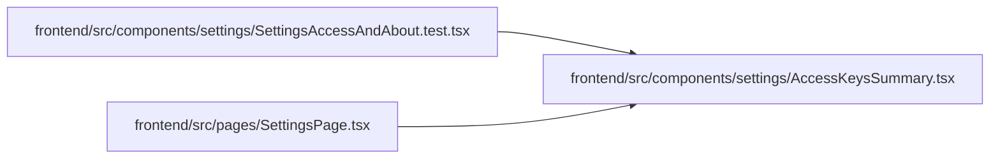

# AccessKeysSummary Module

**Path:** `frontend/src/components/settings/AccessKeysSummary.tsx`

## Description

_Auto-generated from `frontend/src/components/settings/AccessKeysSummary.tsx`._

## Imports

| Source | Symbols | Type-only | Runtime emission |
|--------|---------|-----------|------------------|
| `lucide-react` | `Bot`, `KeyRound` | — | compiler-dependent |
| `react-i18next` | `useTranslation` | — | compiler-dependent |

## Module Signals

| Signal | Values |
|--------|--------|
| Exports | `AccessKeysSummary` |

## Local dependency map

<!-- Auto-generated local dependency summary. Do not edit by hand. -->

### Internal neighbors

| Direction | Module |
|---|---|
| Inbound | [SettingsAccessAndAbout.test](../modules/SettingsAccessAndAbout.test.md) |
| Inbound | [SettingsPage](../modules/SettingsPage.md) |

### External packages

| Language | Used packages | Undeclared packages |
|---|---:|---:|
| typescript | 2 | 0 |

## Functions

| Function | Signature | Decorators | Description |
|----------|-----------|------------|-------------|
| `AccessKeysSummary` | `()` | — | The two keys by the names used everywhere: what each unlocks and how to get it. |
