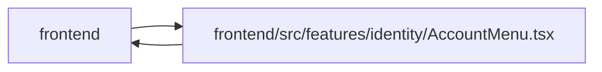

# AccountMenu Module

**Path:** `frontend/src/features/identity/AccountMenu.tsx`

## Description

_Auto-generated from `frontend/src/features/identity/AccountMenu.tsx`._

## Imports

| Source | Symbols | Type-only | Runtime emission |
|--------|---------|-----------|------------------|
| `../../components/common/Button` | `Button` | — | compiler-dependent |
| `../../components/common/Input` | `Input` | — | compiler-dependent |
| `../../components/common/Select` | `Select` | — | compiler-dependent |
| `../../components/settings/protectedQueryKeys` | `protectedQueryKeys` | — | compiler-dependent |
| `../../hooks/useAdminAccess` | `useAdminAccess` | — | compiler-dependent |
| `../../services/adminAccessService` | `verifyAdminApiKey` | — | compiler-dependent |
| `../../services/api` | `api` | — | compiler-dependent |
| `../../services/teamService` | `teamService` | — | compiler-dependent |
| `../../utils/adminAccess` | `ADMIN_API_KEY_CHANGED_EVENT`, `clearAdminApiKey`, `hasAdminApiKey`, `setAdminApiKey` | — | compiler-dependent |
| `../../utils/apiError` | `getApiErrorMessage`, `getApiErrorStatus` | — | compiler-dependent |
| `./LocalProfilePicker` | `LocalProfilePicker` | — | compiler-dependent |
| `./accountMenuRow` | `AccountMenuRowContext` | — | compiler-dependent |
| `./identityContext` | `useIdentity` | — | compiler-dependent |
| `./identityService` | `identityService` | — | compiler-dependent |
| `@tanstack/react-query` | `useQuery`, `useQueryClient` | — | compiler-dependent |
| `lucide-react` | `LogOut`, `User` | — | compiler-dependent |
| `react` | `FormEvent` | Declaration | erased |
| `react` | `useCallback`, `useContext`, `useEffect`, `useId`, `useRef`, `useState` | — | compiler-dependent |
| `react-dom` | `createPortal` | — | compiler-dependent |
| `react-i18next` | `useTranslation` | — | compiler-dependent |
| `react-router-dom` | `Link` | — | compiler-dependent |

## Module Signals

| Signal | Values |
|--------|--------|
| Exports | `IdentityBadge` |

## Local dependency map

<!-- Auto-generated local dependency summary. Do not edit by hand. -->

> Module-level dependencies exceed the generated-diagram limits, so the diagram and table below group them by top-level package. Counts report the number of module neighbors in each package.

### Internal neighbors

| Direction | Module |
|---|---|
| Inbound | `frontend` (3) |
| Outbound | `frontend` (14) |

### External packages

| Language | Used packages | Undeclared packages |
|---|---:|---:|
| typescript | 6 | 0 |

> All 17 module neighbor(s) are summarized by package because the module-level view exceeds the 12-node limit.

## Functions

| Function | Signature | Decorators | Description |
|----------|-----------|------------|-------------|
| `IdentityBadge` | `()` | — | The top-bar account menu: who the work is done as, how the sign-in is established, |
