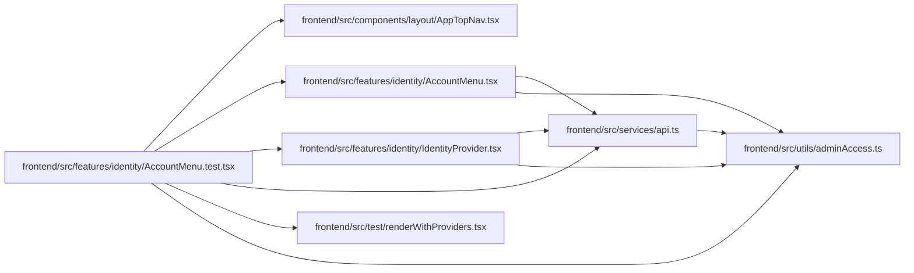

# AccountMenu.test Module

**Path:** `frontend/src/features/identity/AccountMenu.test.tsx`

## Description

_Auto-generated from `frontend/src/features/identity/AccountMenu.test.tsx`._

## Imports

| Source | Symbols | Type-only | Runtime emission |
|--------|---------|-----------|------------------|
| `../../components/layout/AppTopNav` | `AppTopNav` | — | compiler-dependent |
| `../../services/api` | `api`, `IDENTITY_EXPIRED_EVENT` | — | compiler-dependent |
| `../../test/renderWithProviders` | `renderWithProviders` | — | compiler-dependent |
| `../../utils/adminAccess` | `clearAdminApiKey`, `hasAdminApiKey` | — | compiler-dependent |
| `./AccountMenu` | `IdentityBadge` | — | compiler-dependent |
| `./IdentityProvider` | `IdentityProvider` | — | compiler-dependent |
| `@testing-library/react` | `screen`, `waitFor`, `within` | — | compiler-dependent |
| `axios` | `AxiosAdapter`, `AxiosResponse`, `InternalAxiosRequestConfig` | Declaration | erased |
| `axios` | `AxiosError` | — | compiler-dependent |
| `vitest` | `afterEach`, `beforeEach`, `describe`, `expect`, `it`, `vi` | — | compiler-dependent |

## Module Signals

| Signal | Values |
|--------|--------|
| Constants | `originalAdapter`, `service`, `team`, `topBarMocks`, `localWorkspace` |
| Module calls | `service = hoisted`, `mock`, `team = hoisted`, `mock`, `topBarMocks = hoisted`, `mock`, `mock`, `mock`, `mock`, `mock`, `describe` |

## Local dependency map

<!-- Auto-generated local dependency summary. Do not edit by hand. -->

### Internal neighbors

| Direction | Module |
|---|---|
| Outbound | [AppTopNav](../modules/AppTopNav.md) |
| Outbound | [AccountMenu](../modules/AccountMenu.md) |
| Outbound | [IdentityProvider](../modules/IdentityProvider.md) |
| Outbound | [api](../modules/api.md) |
| Outbound | [renderWithProviders](../modules/renderWithProviders.md) |
| Outbound | [adminAccess](../modules/adminAccess.md) |

### External packages

| Language | Used packages | Undeclared packages |
|---|---:|---:|
| typescript | 3 | 0 |
