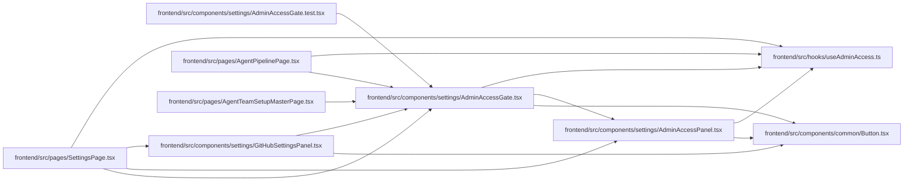

# AdminAccessGate Module

**Path:** `frontend/src/components/settings/AdminAccessGate.tsx`

## Description

_Auto-generated from `frontend/src/components/settings/AdminAccessGate.tsx`._

## Imports

| Source | Symbols | Type-only | Runtime emission |
|--------|---------|-----------|------------------|
| `../../hooks/useAdminAccess` | `useAdminAccess`, `useKeylessReader` | — | compiler-dependent |
| `../common/Button` | `Button` | — | compiler-dependent |
| `./AdminAccessPanel` | `AdminAccessPanel` | — | compiler-dependent |
| `lucide-react` | `LockKeyhole` | — | compiler-dependent |
| `react` | `ReactNode` | Declaration | erased |
| `react` | `useId`, `useState` | — | compiler-dependent |
| `react-i18next` | `useTranslation` | — | compiler-dependent |

## Module Signals

| Signal | Values |
|--------|--------|
| Exports | `AdminAccessGate` |

## Local dependency map

<!-- Auto-generated local dependency summary. Do not edit by hand. -->

### Internal neighbors

| Direction | Module |
|---|---|
| Inbound | [AdminAccessGate.test](../modules/AdminAccessGate.test.md) |
| Inbound | [GitHubSettingsPanel](../modules/GitHubSettingsPanel.md) |
| Inbound | [AgentPipelinePage](../modules/AgentPipelinePage.md) |
| Inbound | [AgentTeamSetupMasterPage](../modules/AgentTeamSetupMasterPage.md) |
| Inbound | [SettingsPage](../modules/SettingsPage.md) |
| Outbound | [Button](../modules/Button.md) |
| Outbound | [AdminAccessPanel](../modules/AdminAccessPanel.md) |
| Outbound | [useAdminAccess](../modules/useAdminAccess.md) |

### External packages

| Language | Used packages | Undeclared packages |
|---|---:|---:|
| typescript | 3 | 0 |

## Classes

| Class | Kind | Line | Bases / Target | Description |
|-------|------|------|----------------|-------------|
| [AdminAccessGateProps](../entities/AdminAccessGateProps.md) | Interface | 9 | — | — |

## Functions

| Function | Signature | Decorators | Description |
|----------|-----------|------------|-------------|
| `AdminAccessGate` | <pre><code>&#40;&#123;&#10;    children&#44;&#10;    showPanel &#61; true&#44;&#10;    recovery&#44;&#10;    accessGranted&#44;&#10;    headingLevel &#61; 3&#44;&#10;    readable &#61; false&#44;&#10;&#125;&#58; AdminAccessGateProps&#41;</code></pre> | — | — |
