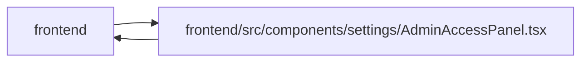

# AdminAccessPanel Module

**Path:** `frontend/src/components/settings/AdminAccessPanel.tsx`

## Description

_Auto-generated from `frontend/src/components/settings/AdminAccessPanel.tsx`._

## Imports

| Source | Symbols | Type-only | Runtime emission |
|--------|---------|-----------|------------------|
| `../../features/identity/OperatorIdentityNotice` | `OperatorIdentityNotice` | — | compiler-dependent |
| `../../features/identity/identityContext` | `useIdentity` | — | compiler-dependent |
| `../../hooks/useAdminAccess` | `useAdminAccess` | — | compiler-dependent |
| `../../services/adminAccessService` | `verifyAdminApiKey` | — | compiler-dependent |
| `../../utils/adminAccess` | `clearAdminApiKey`, `setAdminApiKey` | — | compiler-dependent |
| `../../utils/apiError` | `getApiErrorStatus` | — | compiler-dependent |
| `../common/Button` | `Button` | — | compiler-dependent |
| `../common/Input` | `Input` | — | compiler-dependent |
| `./protectedQueryKeys` | `protectedQueryKeys` | — | compiler-dependent |
| `@tanstack/react-query` | `useQueryClient` | — | compiler-dependent |
| `lucide-react` | `KeyRound`, `ShieldCheck`, `Trash2` | — | compiler-dependent |
| `react` | `useState` | — | compiler-dependent |
| `react-i18next` | `useTranslation` | — | compiler-dependent |

## Module Signals

| Signal | Values |
|--------|--------|
| Exports | `AdminAccessPanel` |

## Local dependency map

<!-- Auto-generated local dependency summary. Do not edit by hand. -->

> Module-level dependencies exceed the generated-diagram limits, so the diagram and table below group them by top-level package. Counts report the number of module neighbors in each package.

### Internal neighbors

| Direction | Module |
|---|---|
| Inbound | `frontend` (4) |
| Outbound | `frontend` (9) |

### External packages

| Language | Used packages | Undeclared packages |
|---|---:|---:|
| typescript | 4 | 0 |

> All 13 module neighbor(s) are summarized by package because the module-level view exceeds the 12-node limit.

## Functions

| Function | Signature | Decorators | Description |
|----------|-----------|------------|-------------|
| `AdminAccessPanel` | <pre><code>&#40;&#123;&#10;    headingLevel &#61; 2&#44;&#10;    saveVariant &#61; &#39;primary&#39;&#44;&#10;&#125;&#58; &#123;&#10;    headingLevel&#63;&#58; 2 &#124; 3&#59;&#10;    &#47;&#42;&#42; Secondary when the page around the panel already leads with a primary action&#46; &#42;&#47;&#10;    saveVariant&#63;&#58; &#39;primary&#39; &#124; &#39;secondary&#39;&#59;&#10;&#125;&#41;</code></pre> | — | — |
