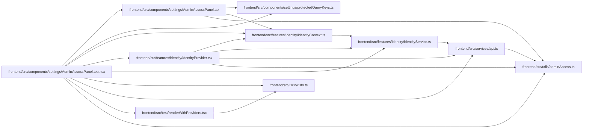

# AdminAccessPanel.test Module

**Path:** `frontend/src/components/settings/AdminAccessPanel.test.tsx`

## Description

_Auto-generated from `frontend/src/components/settings/AdminAccessPanel.test.tsx`._

## Imports

| Source | Symbols | Type-only | Runtime emission |
|--------|---------|-----------|------------------|
| `../../features/identity/IdentityProvider` | `IdentityProvider` | — | compiler-dependent |
| `../../features/identity/identityContext` | `IdentityContext` | — | compiler-dependent |
| `../../features/identity/identityService` | `WorkspaceIdentity` | Declaration | erased |
| `../../i18n/i18n` | `i18n` | — | compiler-dependent |
| `../../services/api` | `api`, `IDENTITY_EXPIRED_EVENT`, `setSessionIntegrity` | — | compiler-dependent |
| `../../test/renderWithProviders` | `createTestQueryClient`, `renderWithProviders` | — | compiler-dependent |
| `../../utils/adminAccess` | `ADMIN_API_KEY_CHANGED_EVENT`, `getAdminApiKey`, `setAdminApiKey` | — | compiler-dependent |
| `./AdminAccessPanel` | `AdminAccessPanel` | — | compiler-dependent |
| `./protectedQueryKeys` | `protectedQueryKeys` | — | compiler-dependent |
| `@testing-library/react` | `act`, `screen`, `waitFor` | — | compiler-dependent |
| `axios` | `AxiosResponse`, `InternalAxiosRequestConfig` | Declaration | erased |
| `axios` | `AxiosError` | — | compiler-dependent |
| `vitest` | `afterEach`, `beforeEach`, `describe`, `expect`, `it`, `vi` | — | compiler-dependent |

## Module Signals

| Signal | Values |
|--------|--------|
| Constants | `local`, `originalAdapter`, `server` |
| Module calls | `server = fn`, `describe` |

## Local dependency map

<!-- Auto-generated local dependency summary. Do not edit by hand. -->
This graph shows full source coupling. Type dependencies can be erased; compiler-dependent cycle groups are runtime candidates, not confirmed initialization cycles.

### Internal neighbors

| Direction | Module |
|---|---|
| Outbound | [AdminAccessPanel](../modules/AdminAccessPanel.md) |
| Outbound | [protectedQueryKeys](../modules/protectedQueryKeys.md) |
| Outbound | [identityContext](../modules/identityContext.md) |
| Outbound | [IdentityProvider](../modules/IdentityProvider.md) |
| Outbound | [identityService](../modules/identityService.md) |
| Outbound | [i18n](../modules/i18n.md) |
| Outbound | [api](../modules/api.md) |
| Outbound | [renderWithProviders](../modules/renderWithProviders.md) |
| Outbound | [adminAccess](../modules/adminAccess.md) |

### External packages

| Language | Used packages | Undeclared packages |
|---|---:|---:|
| typescript | 3 | 0 |
