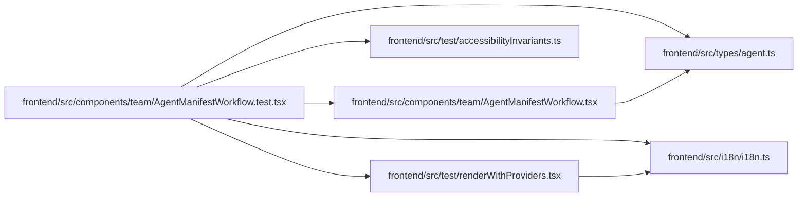

# AgentManifestWorkflow.test Module

**Path:** `frontend/src/components/team/AgentManifestWorkflow.test.tsx`

## Description

_Auto-generated from `frontend/src/components/team/AgentManifestWorkflow.test.tsx`._

## Imports

| Source | Symbols | Type-only | Runtime emission |
|--------|---------|-----------|------------------|
| `../../i18n/i18n` | `i18n`, `ensureLanguageResources` | — | compiler-dependent |
| `../../test/accessibilityInvariants` | `accessibleNameViolations`, `summaryNameViolations` | — | compiler-dependent |
| `../../test/renderWithProviders` | `renderWithProviders` | — | compiler-dependent |
| `../../types/agent` | `AgentTeamStatus` | Declaration | erased |
| `./AgentManifestWorkflow` | `AgentManifestWorkflow` | — | compiler-dependent |
| `@testing-library/react` | `act`, `fireEvent`, `screen`, `waitFor`, `within` | — | compiler-dependent |
| `@testing-library/user-event` | `userEvent` | — | compiler-dependent |
| `axios` | `AxiosError` | — | compiler-dependent |
| `vitest` | `beforeEach`, `describe`, `expect`, `it`, `vi` | — | compiler-dependent |

## Module Signals

| Signal | Values |
|--------|--------|
| Constants | `agentServiceMock`, `useAdminAccessMock`, `statusFixture` |
| Module calls | `agentServiceMock = hoisted`, `useAdminAccessMock = hoisted`, `mock`, `mock`, `describe`, `describe` |

## Local dependency map

<!-- Auto-generated local dependency summary. Do not edit by hand. -->
This graph shows full source coupling. Type dependencies can be erased; compiler-dependent cycle groups are runtime candidates, not confirmed initialization cycles.

### Internal neighbors

| Direction | Module |
|---|---|
| Outbound | [AgentManifestWorkflow](../modules/AgentManifestWorkflow.md) |
| Outbound | [i18n](../modules/i18n.md) |
| Outbound | [accessibilityInvariants](../modules/accessibilityInvariants.md) |
| Outbound | [renderWithProviders](../modules/renderWithProviders.md) |
| Outbound | [types_agent](../modules/types_agent.md) |

### External packages

| Language | Used packages | Undeclared packages |
|---|---:|---:|
| typescript | 4 | 0 |
