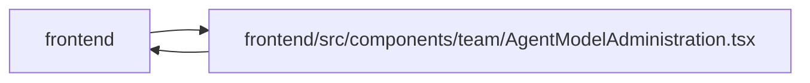

# AgentModelAdministration Module

**Path:** `frontend/src/components/team/AgentModelAdministration.tsx`

## Description

Team’s Models tab reads the catalog and actor bindings through their separate APIs. An operator creates or edits the selected record in a drawer and confirms the audited command. A revision conflict exposes the current revision so the operator can reload. Successful changes invalidate the catalog, bindings, roster and routing previews.

## Imports

| Source | Symbols | Type-only | Runtime emission |
|--------|---------|-----------|------------------|
| `../../components/common/Select` | `Select` | — | compiler-dependent |
| `../../hooks/useAdminAccess` | `useAdminAccess` | — | compiler-dependent |
| `../../hooks/useAgentAccess` | `useAgentAccess` | — | compiler-dependent |
| `../../services/agentService` | `agentService` | — | compiler-dependent |
| `../../types/agent` | `AgentModelBinding`, `AgentModelBindingCreate`, `AgentModelCatalogCreate`, `AgentModelCatalogEntry` | Declaration | erased |
| `../../utils/apiError` | `normalizeApiError` | — | compiler-dependent |
| `../../utils/modelRouting` | `createAgentCommandMetadata`, `parseRoutingTags` | — | compiler-dependent |
| `../../utils/protectedQueries` | `protectedQueryRetry` | — | compiler-dependent |
| `../common/Button` | `Button` | — | compiler-dependent |
| `../common/ButtonLink` | `ButtonLink` | — | compiler-dependent |
| `../common/Checkbox` | `Checkbox` | — | compiler-dependent |
| `../common/Input` | `Input`, `RequiredIndicator` | — | compiler-dependent |
| `../common/Modal` | `Modal` | — | compiler-dependent |
| `../common/useConfirmDialog` | `useConfirmDialog` | — | compiler-dependent |
| `../feedback/QueryState` | `QueryErrorState`, `QueryLoadingState` | — | compiler-dependent |
| `../feedback/toast` | `useToast` | — | compiler-dependent |
| `../ui` | `InlineEmptyState` | — | compiler-dependent |
| `../ui/OverflowMenu` | `OverflowMenuItem` | Declaration | erased |
| `../ui/SlideOverDrawer` | `SlideOverDrawer` | — | compiler-dependent |
| `./ModelBindings` | `ModelBindings` | — | compiler-dependent |
| `./ModelCatalog` | `ModelCatalog` | — | compiler-dependent |
| `@tanstack/react-query` | `useMutation`, `useQuery`, `useQueryClient` | — | compiler-dependent |
| `lucide-react` | `AlertTriangle`, `Database`, `Link2`, `Plus`, `X` | — | compiler-dependent |
| `react` | `ReactNode` | Specifier | compiler-dependent |
| `react` | `useCallback`, `useEffect`, `useMemo`, `useRef`, `useState` | — | compiler-dependent |
| `react-i18next` | `useTranslation` | — | compiler-dependent |

## Module Signals

| Signal | Values |
|--------|--------|
| Exports | `AgentModelAdministration`, `ModelHeaderActions` |
| Constants | `EMPTY_CATALOG_FORM`, `EMPTY_BINDING_FORM` |

## Local dependency map

<!-- Auto-generated local dependency summary. Do not edit by hand. -->
This graph shows full source coupling. Type dependencies can be erased; compiler-dependent cycle groups are runtime candidates, not confirmed initialization cycles.

> Module-level dependencies exceed the generated-diagram limits, so the diagram and table below group them by top-level package. Counts report the number of module neighbors in each package.

### Internal neighbors

| Direction | Module |
|---|---|
| Inbound | `frontend` (2) |
| Outbound | `frontend` (21) |

### External packages

| Language | Used packages | Undeclared packages |
|---|---:|---:|
| typescript | 4 | 0 |

> All 23 module neighbor(s) are summarized by package because the module-level view exceeds the 12-node limit.

## Classes

| Class | Kind | Line | Bases / Target | Description |
|-------|------|------|----------------|-------------|
| [CatalogForm](../entities/CatalogForm.md) | Interface | 41 | — | — |
| [BindingForm](../entities/BindingForm.md) | Interface | 56 | — | — |
| [ConflictResolution](../entities/ConflictResolution.md) | Interface | 66 | — | — |
| [ModelHeaderActions](../entities/ModelHeaderActions.md) | Interface | 128 | — | — |

## Functions

| Function | Signature | Decorators | Description |
|----------|-----------|------------|-------------|
| `AgentModelAdministration` | <pre><code>&#40;&#123; onHeaderActionsChange &#125;&#58; &#123;&#10;    onHeaderActionsChange&#63;&#58; &#40;actions&#58; ModelHeaderActions &#124; null&#41; &#61;&#62; void&#59;&#10;&#125;&#41;</code></pre> | — | — |
