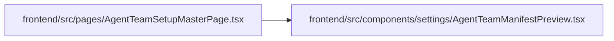

# AgentTeamManifestPreview Module

**Path:** `frontend/src/components/settings/AgentTeamManifestPreview.tsx`

## Description

_Auto-generated from `frontend/src/components/settings/AgentTeamManifestPreview.tsx`._

## Imports

| Source | Symbols | Type-only | Runtime emission |
|--------|---------|-----------|------------------|
| `react` | `useMemo` | — | compiler-dependent |
| `react-i18next` | `useTranslation` | — | compiler-dependent |

## Module Signals

| Signal | Values |
|--------|--------|
| Exports | `AgentTeamManifestPreview` |

## Local dependency map

<!-- Auto-generated local dependency summary. Do not edit by hand. -->

### Internal neighbors

| Direction | Module |
|---|---|
| Inbound | [AgentTeamSetupMasterPage](../modules/AgentTeamSetupMasterPage.md) |

### External packages

| Language | Used packages | Undeclared packages |
|---|---:|---:|
| typescript | 2 | 0 |

## Classes

| Class | Kind | Line | Bases / Target | Description |
|-------|------|------|----------------|-------------|
| [Member](../entities/Member.md) | Type alias | 4 | `Record<string, unknown> & { skill_package?: { name?: string; version?: string } }` | — |

## Functions

| Function | Signature | Decorators | Description |
|----------|-----------|------------|-------------|
| `AgentTeamManifestPreview` | `({ text }: { text: string })` | — | What the JSON describes, read beside it: the controller, workers and verifiers, and what each is missing. |
