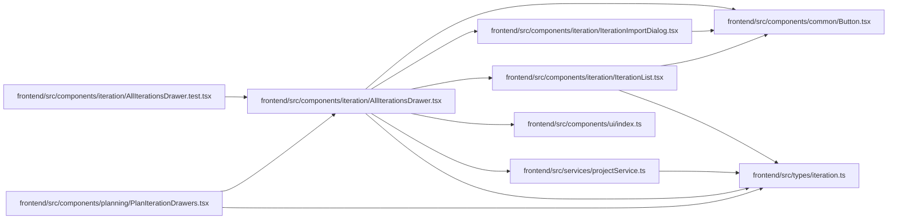

# AllIterationsDrawer Module

**Path:** `frontend/src/components/iteration/AllIterationsDrawer.tsx`

## Description

_Auto-generated from `frontend/src/components/iteration/AllIterationsDrawer.tsx`._

## Imports

| Source | Symbols | Type-only | Runtime emission |
|--------|---------|-----------|------------------|
| `../../services/projectService` | `projectService` | — | compiler-dependent |
| `../../types/iteration` | `Iteration` | Declaration | erased |
| `../common/Button` | `Button` | — | compiler-dependent |
| `../ui` | `SlideOverDrawer` | — | compiler-dependent |
| `./IterationImportDialog` | `IterationImportDialog` | — | compiler-dependent |
| `./IterationList` | `IterationList` | — | compiler-dependent |
| `@tanstack/react-query` | `useQuery` | — | compiler-dependent |
| `lucide-react` | `Upload` | — | compiler-dependent |
| `react` | `ChangeEvent` | Declaration | erased |
| `react` | `useRef`, `useState` | — | compiler-dependent |
| `react-i18next` | `useTranslation` | — | compiler-dependent |

## Module Signals

| Signal | Values |
|--------|--------|
| Exports | `AllIterationsDrawer` |

## Local dependency map

<!-- Auto-generated local dependency summary. Do not edit by hand. -->
This graph shows full source coupling. Type dependencies can be erased; compiler-dependent cycle groups are runtime candidates, not confirmed initialization cycles.

### Internal neighbors

| Direction | Module |
|---|---|
| Inbound | [AllIterationsDrawer.test](../modules/AllIterationsDrawer.test.md) |
| Inbound | [PlanIterationDrawers](../modules/PlanIterationDrawers.md) |
| Outbound | [Button](../modules/Button.md) |
| Outbound | [IterationImportDialog](../modules/IterationImportDialog.md) |
| Outbound | [IterationList](../modules/IterationList.md) |
| Outbound | [index](../modules/index.md) |
| Outbound | [projectService](../modules/projectService.md) |
| Outbound | [types_iteration](../modules/types_iteration.md) |

### External packages

| Language | Used packages | Undeclared packages |
|---|---:|---:|
| typescript | 4 | 0 |

## Classes

| Class | Kind | Line | Bases / Target | Description |
|-------|------|------|----------------|-------------|
| [AllIterationsDrawerProps](../entities/AllIterationsDrawerProps.md) | Interface | 13 | — | — |

## Functions

| Function | Signature | Decorators | Description |
|----------|-----------|------------|-------------|
| `AllIterationsDrawer` | `({ projectId, onOpen, onEdit, onClose }: AllIterationsDrawerProps)` | — | Every iteration of the project in scope, with Open, Edit, Export and Delete per row and Import in the header. |
