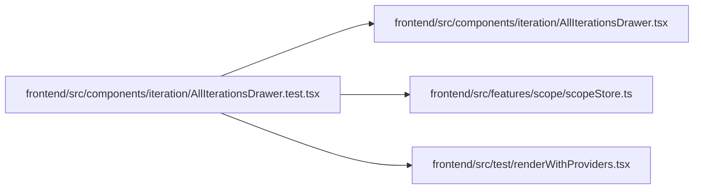

# AllIterationsDrawer.test Module

**Path:** `frontend/src/components/iteration/AllIterationsDrawer.test.tsx`

## Description

_Auto-generated from `frontend/src/components/iteration/AllIterationsDrawer.test.tsx`._

## Imports

| Source | Symbols | Type-only | Runtime emission |
|--------|---------|-----------|------------------|
| `../../features/scope/scopeStore` | `useScopeStore` | — | compiler-dependent |
| `../../test/renderWithProviders` | `renderWithProviders` | — | compiler-dependent |
| `./AllIterationsDrawer` | `AllIterationsDrawer` | — | compiler-dependent |
| `@testing-library/react` | `act`, `screen`, `waitFor`, `within` | — | compiler-dependent |
| `axios` | `AxiosError` | — | compiler-dependent |
| `vitest` | `afterEach`, `beforeEach`, `describe`, `expect`, `it`, `vi` | — | compiler-dependent |

## Module Signals

| Signal | Values |
|--------|--------|
| Constants | `iterationServiceMock`, `projectServiceMock`, `planningMock`, `exportMock`, `ITERATIONS` |
| Module calls | `iterationServiceMock = hoisted`, `projectServiceMock = hoisted`, `planningMock = hoisted`, `exportMock = hoisted`, `mock`, `mock`, `mock`, `mock`, `describe` |

## Local dependency map

<!-- Auto-generated local dependency summary. Do not edit by hand. -->

### Internal neighbors

| Direction | Module |
|---|---|
| Outbound | [AllIterationsDrawer](../modules/AllIterationsDrawer.md) |
| Outbound | [scopeStore](../modules/scopeStore.md) |
| Outbound | [renderWithProviders](../modules/renderWithProviders.md) |

### External packages

| Language | Used packages | Undeclared packages |
|---|---:|---:|
| typescript | 3 | 0 |
