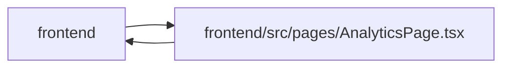

# AnalyticsPage Module

**Path:** `frontend/src/pages/AnalyticsPage.tsx`

## Description

_Auto-generated from `frontend/src/pages/AnalyticsPage.tsx`._

## Imports

| Source | Symbols | Type-only | Runtime emission |
|--------|---------|-----------|------------------|
| `../components/analytics/DeliveryAnalytics` | `DeliveryAnalytics` | — | compiler-dependent |
| `../components/analytics/ExecutionUsagePanel` | `ExecutionUsagePanel` | — | compiler-dependent |
| `../components/analytics/OnTrackSummary` | `OnTrackSummary` | — | compiler-dependent |
| `../components/analytics/StatusDistribution` | `StatusDistribution` | — | compiler-dependent |
| `../components/analytics/useAnalyticsScope` | `useAnalyticsScope` | — | compiler-dependent |
| `../components/common/Select` | `Select` | — | compiler-dependent |
| `../components/feedback/QueryState` | `QueryErrorState` | — | compiler-dependent |
| `../components/tasks/WorkMetricsLine` | `WorkMetricsLine` | — | compiler-dependent |
| `../components/ui` | `PageHeader`, `PageLayout`, `PageToolbar` | — | compiler-dependent |
| `../features/scope/useWorkScope` | `useWorkScope` | — | compiler-dependent |
| `../services/iterationService` | `iterationService` | — | compiler-dependent |
| `@tanstack/react-query` | `useQuery` | — | compiler-dependent |
| `react` | `useState` | — | compiler-dependent |
| `react-i18next` | `useTranslation` | — | compiler-dependent |

## Module Signals

| Signal | Values |
|--------|--------|
| Exports | `default` |

## Local dependency map

<!-- Auto-generated local dependency summary. Do not edit by hand. -->

> Module-level dependencies exceed the generated-diagram limits, so the diagram and table below group them by top-level package. Counts report the number of module neighbors in each package.

### Internal neighbors

| Direction | Module |
|---|---|
| Inbound | `frontend` (4) |
| Outbound | `frontend` (11) |

### External packages

| Language | Used packages | Undeclared packages |
|---|---:|---:|
| typescript | 3 | 0 |

> All 15 module neighbor(s) are summarized by package because the module-level view exceeds the 12-node limit.
