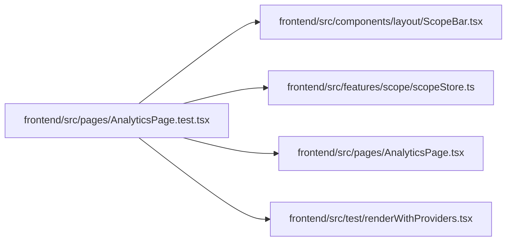

# AnalyticsPage.test Module

**Path:** `frontend/src/pages/AnalyticsPage.test.tsx`

## Description

_Auto-generated from `frontend/src/pages/AnalyticsPage.test.tsx`._

## Imports

| Source | Symbols | Type-only | Runtime emission |
|--------|---------|-----------|------------------|
| `../components/layout/ScopeBar` | `ScopeBar` | — | compiler-dependent |
| `../features/scope/scopeStore` | `useScopeStore` | — | compiler-dependent |
| `../test/renderWithProviders` | `renderWithProviders` | — | compiler-dependent |
| `./AnalyticsPage` | `AnalyticsPage` | — | compiler-dependent |
| `@testing-library/react` | `act`, `fireEvent`, `screen`, `waitFor`, `within` | — | compiler-dependent |
| `vitest` | `afterEach`, `beforeEach`, `describe`, `expect`, `it`, `vi` | — | compiler-dependent |

## Module Signals

| Signal | Values |
|--------|--------|
| Constants | `metrics`, `usage`, `iterationServiceMock`, `projectServiceMock`, `sample`, `report` |
| Module calls | `metrics = hoisted`, `usage = hoisted`, `iterationServiceMock = hoisted`, `projectServiceMock = hoisted`, `mock`, `mock`, `mock`, `mock`, `mock`, `mock`, `mock`, `describe` |

## Local dependency map

<!-- Auto-generated local dependency summary. Do not edit by hand. -->

### Internal neighbors

| Direction | Module |
|---|---|
| Outbound | [ScopeBar](../modules/ScopeBar.md) |
| Outbound | [scopeStore](../modules/scopeStore.md) |
| Outbound | [AnalyticsPage](../modules/AnalyticsPage.md) |
| Outbound | [renderWithProviders](../modules/renderWithProviders.md) |

### External packages

| Language | Used packages | Undeclared packages |
|---|---:|---:|
| typescript | 2 | 0 |
