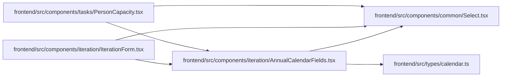

# AnnualCalendarFields Module

**Path:** `frontend/src/components/iteration/AnnualCalendarFields.tsx`

## Description

_Auto-generated from `frontend/src/components/iteration/AnnualCalendarFields.tsx`._

## Imports

| Source | Symbols | Type-only | Runtime emission |
|--------|---------|-----------|------------------|
| `../../types/calendar` | `Calendar` | Declaration | erased |
| `../common/Select` | `Select` | — | compiler-dependent |
| `react-i18next` | `useTranslation` | — | compiler-dependent |

## Module Signals

| Signal | Values |
|--------|--------|
| Exports | `AnnualCalendarFields` |

## Local dependency map

<!-- Auto-generated local dependency summary. Do not edit by hand. -->
This graph shows full source coupling. Type dependencies can be erased; compiler-dependent cycle groups are runtime candidates, not confirmed initialization cycles.

### Internal neighbors

| Direction | Module |
|---|---|
| Inbound | [IterationForm](../modules/IterationForm.md) |
| Inbound | [PersonCapacity](../modules/PersonCapacity.md) |
| Outbound | [Select](../modules/Select.md) |
| Outbound | [types_calendar](../modules/types_calendar.md) |

### External packages

| Language | Used packages | Undeclared packages |
|---|---:|---:|
| typescript | 1 | 0 |

## Classes

| Class | Kind | Line | Bases / Target | Description |
|-------|------|------|----------------|-------------|
| [Props](../entities/AnnualCalendarFields_Props.md) | Interface | 5 | — | — |

## Functions

| Function | Signature | Decorators | Description |
|----------|-----------|------------|-------------|
| `AnnualCalendarFields` | `({ calendars, primary, startDate, endDate, selected, onChange, disabled }: Props)` | — | — |
