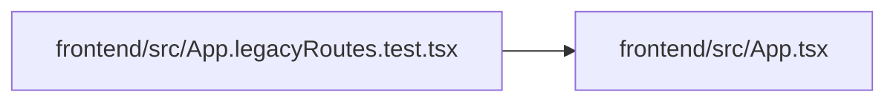

# App.legacyRoutes.test Module

**Path:** `frontend/src/App.legacyRoutes.test.tsx`

## Description

_Auto-generated from `frontend/src/App.legacyRoutes.test.tsx`._

## Imports

| Source | Symbols | Type-only | Runtime emission |
|--------|---------|-----------|------------------|
| `./App` | `App` | — | compiler-dependent |
| `@testing-library/react` | `render`, `screen` | — | compiler-dependent |
| `react` | `ReactNode` | Declaration | erased |
| `react-router-dom` | `MemoryRouter`, `useLocation` | — | compiler-dependent |
| `vitest` | `describe`, `expect`, `it`, `vi` | — | compiler-dependent |

## Module Signals

| Signal | Values |
|--------|--------|
| Module calls | `mock`, `mock`, `describe` |

## Local dependency map

<!-- Auto-generated local dependency summary. Do not edit by hand. -->

### Internal neighbors

| Direction | Module |
|---|---|
| Outbound | [App](../modules/App.md) |

### External packages

| Language | Used packages | Undeclared packages |
|---|---:|---:|
| typescript | 4 | 0 |
