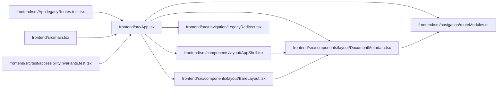

# App Module

**Path:** `frontend/src/App.tsx`

## Description

The workspace shell groups task work, projects, planning, team administration and settings into separately loaded routes. Bookmarks for earlier destinations pass through the legacy redirect map. Shared plans and native device connections use the bare layout so they can open outside the workspace shell.

## Imports

| Source | Symbols | Type-only | Runtime emission |
|--------|---------|-----------|------------------|
| `./components/layout/AppShell` | `AppShell` | — | compiler-dependent |
| `./components/layout/BareLayout` | `BareLayout` | — | compiler-dependent |
| `./components/layout/DocumentMetadata` | `DocumentMetadata` | — | compiler-dependent |
| `./navigation/LegacyRedirect` | `LegacyRedirect` | — | compiler-dependent |
| `./navigation/routeModules` | `routeModuleLoaders` | — | compiler-dependent |
| `lucide-react` | `LoaderCircle` | — | compiler-dependent |
| `react` | `lazy`, `Suspense` | — | compiler-dependent |
| `react-i18next` | `useTranslation` | — | compiler-dependent |
| `react-router-dom` | `Route`, `Routes` | — | compiler-dependent |

## Module Signals

| Signal | Values |
|--------|--------|
| Exports | `RouteLoadingState`, `default` |
| Constants | `OverviewPage`, `LandingPage`, `PlanPage`, `PlanSharePage`, `TeamPage`, `TasksPage`, `MyWorkPage`, `NativeConnectionPage`, `TriagePage`, `ProjectsPage`, `ProjectDetailPage`, `ProjectReleaseDetailPage`, `GanttPage`, `AnalyticsPage`, `SettingsPage`, `NotFoundPage` |
| Module calls | `OverviewPage = lazy`, `LandingPage = lazy`, `PlanPage = lazy`, `PlanSharePage = lazy`, `TeamPage = lazy`, `TasksPage = lazy`, `MyWorkPage = lazy`, `NativeConnectionPage = lazy`, `TriagePage = lazy`, `ProjectsPage = lazy`, `ProjectDetailPage = lazy`, `ProjectReleaseDetailPage = lazy`, `GanttPage = lazy`, `AnalyticsPage = lazy`, `SettingsPage = lazy`, `NotFoundPage = lazy` |

## Local dependency map

<!-- Auto-generated local dependency summary. Do not edit by hand. -->

### Internal neighbors

| Direction | Module |
|---|---|
| Inbound | [App.legacyRoutes.test](../modules/App.legacyRoutes.test.md) |
| Inbound | [src_main](../modules/src_main.md) |
| Inbound | [accessibilityInvariants.test](../modules/accessibilityInvariants.test.md) |
| Outbound | [AppShell](../modules/AppShell.md) |
| Outbound | [BareLayout](../modules/BareLayout.md) |
| Outbound | [DocumentMetadata](../modules/DocumentMetadata.md) |
| Outbound | [LegacyRedirect](../modules/LegacyRedirect.md) |
| Outbound | [routeModules](../modules/routeModules.md) |

### External packages

| Language | Used packages | Undeclared packages |
|---|---:|---:|
| typescript | 4 | 0 |

## Functions

| Function | Signature | Decorators | Description |
|----------|-----------|------------|-------------|
| `App` | `()` | — | — |
| `RouteLoadingState` | `()` | — | — |
