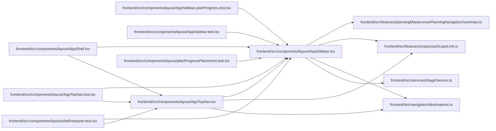

# AppSidebar Module

**Path:** `frontend/src/components/layout/AppSidebar.tsx`

## Description

_Auto-generated from `frontend/src/components/layout/AppSidebar.tsx`._

## Imports

| Source | Symbols | Type-only | Runtime emission |
|--------|---------|-----------|------------------|
| `../../features/planningMasters/usePlanningNavigationSummary` | `usePlanningNavigationSummary` | — | compiler-dependent |
| `../../features/scope/useScopeLink` | `useScopeLink` | — | compiler-dependent |
| `../../navigation/destinations` | `Destination`, `DestinationCounterValues` | Declaration | erased |
| `../../navigation/destinations` | `DESTINATION_GROUPS`, `formatDestinationCounter`, `getCounterSource`, `getDestinationForPath` | — | compiler-dependent |
| `../../services/triageService` | `triageService` | — | compiler-dependent |
| `@tanstack/react-query` | `useQuery` | — | compiler-dependent |
| `react` | `useId` | — | compiler-dependent |
| `react-i18next` | `useTranslation` | — | compiler-dependent |
| `react-router-dom` | `Link`, `useLocation` | — | compiler-dependent |

## Module Signals

| Signal | Values |
|--------|--------|
| Exports | `AppSidebar`, `SidebarContent` |

## Local dependency map

<!-- Auto-generated local dependency summary. Do not edit by hand. -->
This graph shows full source coupling. Type dependencies can be erased; compiler-dependent cycle groups are runtime candidates, not confirmed initialization cycles.

### Internal neighbors

| Direction | Module |
|---|---|
| Inbound | [AppShell](../modules/AppShell.md) |
| Inbound | [AppSidebar.planProgress.test](../modules/AppSidebar.planProgress.test.md) |
| Inbound | [AppSidebar.test](../modules/AppSidebar.test.md) |
| Inbound | [AppTopNav.test](../modules/AppTopNav.test.md) |
| Inbound | [AppTopNav](../modules/AppTopNav.md) |
| Inbound | [planProgressPlacement.test](../modules/planProgressPlacement.test.md) |
| Inbound | [shellViewport.test](../modules/shellViewport.test.md) |
| Outbound | [usePlanningNavigationSummary](../modules/usePlanningNavigationSummary.md) |
| Outbound | [useScopeLink](../modules/useScopeLink.md) |
| Outbound | [destinations](../modules/destinations.md) |
| Outbound | [triageService](../modules/triageService.md) |

### External packages

| Language | Used packages | Undeclared packages |
|---|---:|---:|
| typescript | 4 | 0 |

## Functions

| Function | Signature | Decorators | Description |
|----------|-----------|------------|-------------|
| `SidebarContent` | `({ onNavigate }: { onNavigate?: () => void })` | — | The ten destinations in their groups. The desktop sidebar and the drawer both render this. |
| `AppSidebar` | `()` | — | — |
