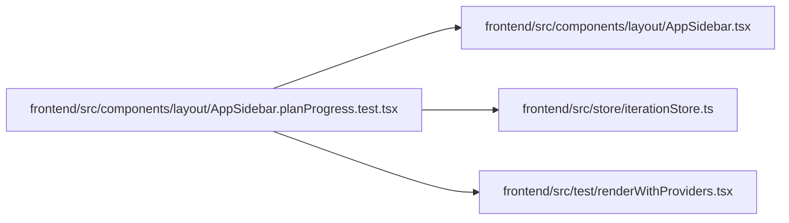

# AppSidebar.planProgress.test Module

**Path:** `frontend/src/components/layout/AppSidebar.planProgress.test.tsx`

## Description

_Auto-generated from `frontend/src/components/layout/AppSidebar.planProgress.test.tsx`._

## Imports

| Source | Symbols | Type-only | Runtime emission |
|--------|---------|-----------|------------------|
| `../../store/iterationStore` | `useIterationStore` | — | compiler-dependent |
| `../../test/renderWithProviders` | `renderWithProviders` | — | compiler-dependent |
| `./AppSidebar` | `AppSidebar` | — | compiler-dependent |
| `@testing-library/react` | `screen`, `within` | — | compiler-dependent |
| `vitest` | `beforeEach`, `describe`, `expect`, `it`, `vi` | — | compiler-dependent |

## Module Signals

| Signal | Values |
|--------|--------|
| Constants | `services`, `iteration`, `readinessResponse` |
| Module calls | `services = hoisted`, `mock`, `mock`, `describe` |

## Local dependency map

<!-- Auto-generated local dependency summary. Do not edit by hand. -->

### Internal neighbors

| Direction | Module |
|---|---|
| Outbound | [AppSidebar](../modules/AppSidebar.md) |
| Outbound | [iterationStore](../modules/iterationStore.md) |
| Outbound | [renderWithProviders](../modules/renderWithProviders.md) |

### External packages

| Language | Used packages | Undeclared packages |
|---|---:|---:|
| typescript | 2 | 0 |
