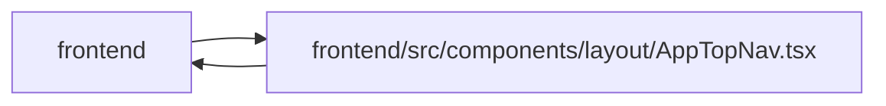

# AppTopNav Module

**Path:** `frontend/src/components/layout/AppTopNav.tsx`

## Description

_Auto-generated from `frontend/src/components/layout/AppTopNav.tsx`._

## Imports

| Source | Symbols | Type-only | Runtime emission |
|--------|---------|-----------|------------------|
| `../../components/common/Button` | `Button` | — | compiler-dependent |
| `../../features/identity/accountMenuRow` | `AccountMenuRowContext` | — | compiler-dependent |
| `../../features/scope/useScopeLink` | `useScopeLink` | — | compiler-dependent |
| `../../navigation/destinations` | `getDestinationForPath` | — | compiler-dependent |
| `../../navigation/routeModules` | `metadataForPath`, `warmRouteModule` | — | compiler-dependent |
| `../UserSessionBadge` | `UserSessionBadge` | — | compiler-dependent |
| `../common/dialogLayer` | `useDialogLayer` | — | compiler-dependent |
| `./AppSidebar` | `SidebarContent` | — | compiler-dependent |
| `./BrandMark` | `BrandMark` | — | compiler-dependent |
| `./ContextHelp` | `ContextHelp` | — | compiler-dependent |
| `./ScopeBar` | `ScopeBar` | — | compiler-dependent |
| `./commandMenuEvents` | `openCommandMenu` | — | compiler-dependent |
| `lucide-react` | `Command`, `Menu`, `X` | — | compiler-dependent |
| `react` | `useEffect`, `useRef`, `useState` | — | compiler-dependent |
| `react-i18next` | `useTranslation` | — | compiler-dependent |
| `react-router-dom` | `Link`, `useLocation` | — | compiler-dependent |

## Module Signals

| Signal | Values |
|--------|--------|
| Exports | `AppTopNav` |
| Constants | `MOBILE_NAV_TITLE_ID`, `PHONE_QUERY` |

## Local dependency map

<!-- Auto-generated local dependency summary. Do not edit by hand. -->

> Module-level dependencies exceed the generated-diagram limits, so the diagram and table below group them by top-level package. Counts report the number of module neighbors in each package.

### Internal neighbors

| Direction | Module |
|---|---|
| Inbound | `frontend` (4) |
| Outbound | `frontend` (12) |

### External packages

| Language | Used packages | Undeclared packages |
|---|---:|---:|
| typescript | 4 | 0 |

> All 16 module neighbor(s) are summarized by package because the module-level view exceeds the 12-node limit.

## Functions

| Function | Signature | Decorators | Description |
|----------|-----------|------------|-------------|
| `AppTopNav` | `()` | — | — |
