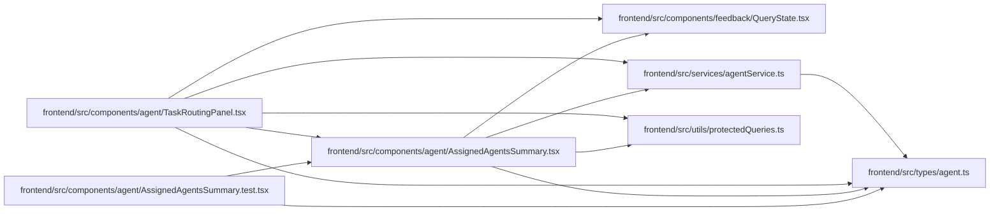

# AssignedAgentsSummary Module

**Path:** `frontend/src/components/agent/AssignedAgentsSummary.tsx`

## Description

Read-only list of the agents assigned to a task, read with the person's own access and shown in the routing panel when the browser holds no agent key: each agent's name, purpose, state and declared model, with loading, empty and retryable error states.

## Imports

| Source | Symbols | Type-only | Runtime emission |
|--------|---------|-----------|------------------|
| `../../services/agentService` | `agentService` | — | compiler-dependent |
| `../../types/agent` | `AgentAssignmentReadItem` | Declaration | erased |
| `../../utils/protectedQueries` | `protectedQueryRetry` | — | compiler-dependent |
| `../feedback/QueryState` | `QueryEmptyState`, `QueryErrorState`, `QueryLoadingState` | — | compiler-dependent |
| `@tanstack/react-query` | `useQuery` | — | compiler-dependent |
| `react-i18next` | `useTranslation` | — | compiler-dependent |

## Module Signals

| Signal | Values |
|--------|--------|
| Exports | `AssignedAgentsSummary` |
| Constants | `KNOWN_PURPOSES`, `KNOWN_STATES` |
| Module calls | `KNOWN_PURPOSES = Set`, `KNOWN_STATES = Set` |

## Local dependency map

<!-- Auto-generated local dependency summary. Do not edit by hand. -->
This graph shows full source coupling. Type dependencies can be erased; compiler-dependent cycle groups are runtime candidates, not confirmed initialization cycles.

### Internal neighbors

| Direction | Module |
|---|---|
| Inbound | [AssignedAgentsSummary.test](../modules/AssignedAgentsSummary.test.md) |
| Inbound | [TaskRoutingPanel](../modules/TaskRoutingPanel.md) |
| Outbound | [QueryState](../modules/QueryState.md) |
| Outbound | [agentService](../modules/agentService.md) |
| Outbound | [types_agent](../modules/types_agent.md) |
| Outbound | [protectedQueries](../modules/protectedQueries.md) |

### External packages

| Language | Used packages | Undeclared packages |
|---|---:|---:|
| typescript | 2 | 0 |

## Functions

| Function | Signature | Decorators | Description |
|----------|-----------|------------|-------------|
| `AssignedAgentsSummary` | `({ taskId }: { taskId: number })` | — | Who holds a task, read with the person's own access: no agent key, no routing evidence. |
