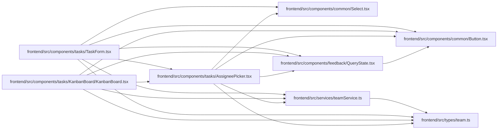

# AssigneePicker Module

**Path:** `frontend/src/components/tasks/AssigneePicker.tsx`

## Description

_Auto-generated from `frontend/src/components/tasks/AssigneePicker.tsx`._

## Imports

| Source | Symbols | Type-only | Runtime emission |
|--------|---------|-----------|------------------|
| `../../components/common/Button` | `Button` | — | compiler-dependent |
| `../../components/common/Select` | `Select` | — | compiler-dependent |
| `../../services/teamService` | `teamService` | — | compiler-dependent |
| `../../types/team` | `TeamMember`, `TeamMemberProfile` | Declaration | erased |
| `../feedback/QueryState` | `QueryErrorState` | — | compiler-dependent |
| `@tanstack/react-query` | `useQueries`, `useQuery` | — | compiler-dependent |
| `react-i18next` | `useTranslation` | — | compiler-dependent |

## Module Signals

| Signal | Values |
|--------|--------|
| Exports | `AssigneePicker` |

## Local dependency map

<!-- Auto-generated local dependency summary. Do not edit by hand. -->
This graph shows full source coupling. Type dependencies can be erased; compiler-dependent cycle groups are runtime candidates, not confirmed initialization cycles.

### Internal neighbors

| Direction | Module |
|---|---|
| Inbound | [KanbanBoard](../modules/KanbanBoard.md) |
| Inbound | [TaskForm](../modules/TaskForm.md) |
| Outbound | [Button](../modules/Button.md) |
| Outbound | [Select](../modules/Select.md) |
| Outbound | [QueryState](../modules/QueryState.md) |
| Outbound | [teamService](../modules/teamService.md) |
| Outbound | [types_team](../modules/types_team.md) |

### External packages

| Language | Used packages | Undeclared packages |
|---|---:|---:|
| typescript | 2 | 0 |

## Functions

| Function | Signature | Decorators | Description |
|----------|-----------|------------|-------------|
| `AssigneePicker` | <pre><code>&#40;&#123; id&#44; members&#44; value&#44; profile&#44; disabled&#44; allowAdd&#44; onChange &#125;&#58; &#123;&#10;    id&#58; string&#59; members&#58; TeamMember&#91;&#93;&#59; value&#58; number &#124; null&#59; profile&#58; TeamMemberProfile &#124; null&#59;&#10;    disabled&#58; boolean&#59; allowAdd&#58; boolean&#59;&#10;    onChange&#58; &#40;memberId&#58; number &#124; null&#44; profile&#58; TeamMemberProfile &#124; null&#41; &#61;&#62; void&#59;&#10;&#125;&#41;</code></pre> | — | — |
