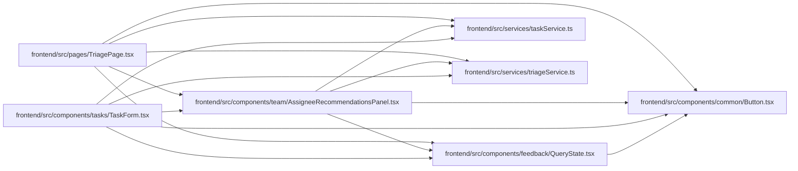

# AssigneeRecommendationsPanel Module

**Path:** `frontend/src/components/team/AssigneeRecommendationsPanel.tsx`

## Description

_Auto-generated from `frontend/src/components/team/AssigneeRecommendationsPanel.tsx`._

## Imports

| Source | Symbols | Type-only | Runtime emission |
|--------|---------|-----------|------------------|
| `../../services/taskService` | `taskService` | — | compiler-dependent |
| `../../services/triageService` | `triageService` | — | compiler-dependent |
| `../common/Button` | `Button` | — | compiler-dependent |
| `../feedback/QueryState` | `QueryErrorState` | — | compiler-dependent |
| `@tanstack/react-query` | `useQuery` | — | compiler-dependent |
| `lucide-react` | `AlertTriangle`, `CheckCircle2`, `UserCheck` | — | compiler-dependent |
| `react-i18next` | `useTranslation` | — | compiler-dependent |

## Module Signals

| Signal | Values |
|--------|--------|
| Exports | `AssigneeRecommendationsPanel` |

## Local dependency map

<!-- Auto-generated local dependency summary. Do not edit by hand. -->

### Internal neighbors

| Direction | Module |
|---|---|
| Inbound | [TaskForm](../modules/TaskForm.md) |
| Inbound | [TriagePage](../modules/TriagePage.md) |
| Outbound | [Button](../modules/Button.md) |
| Outbound | [QueryState](../modules/QueryState.md) |
| Outbound | [taskService](../modules/taskService.md) |
| Outbound | [triageService](../modules/triageService.md) |

### External packages

| Language | Used packages | Undeclared packages |
|---|---:|---:|
| typescript | 3 | 0 |

## Classes

| Class | Kind | Line | Bases / Target | Description |
|-------|------|------|----------------|-------------|
| [AssigneeRecommendationsPanelProps](../entities/AssigneeRecommendationsPanelProps.md) | Interface | 9 | — | — |

## Functions

| Function | Signature | Decorators | Description |
|----------|-----------|------------|-------------|
| `AssigneeRecommendationsPanel` | <pre><code>&#40;&#123;&#10;    targetType&#44;&#10;    taskId&#44;&#10;    triageItemId&#44;&#10;    iterationId&#44;&#10;    selectedAssigneeId&#44;&#10;    onSelectAssignee&#44;&#10;&#125;&#58; AssigneeRecommendationsPanelProps&#41;</code></pre> | — | — |
