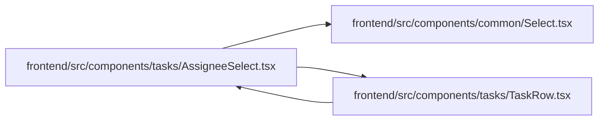

# AssigneeSelect Module

**Path:** `frontend/src/components/tasks/AssigneeSelect.tsx`

## Description

_Auto-generated from `frontend/src/components/tasks/AssigneeSelect.tsx`._

## Imports

| Source | Symbols | Type-only | Runtime emission |
|--------|---------|-----------|------------------|
| `../../components/common/Select` | `Select` | — | compiler-dependent |
| `./TaskRow` | `TaskRowAssigneeOption` | Declaration | erased |
| `react` | `ComponentProps` | Declaration | erased |

## Module Signals

| Signal | Values |
|--------|--------|
| Exports | `AssigneeSelect`, `AssigneeSelectProps` |

## Local dependency map

<!-- Auto-generated local dependency summary. Do not edit by hand. -->
This graph shows full source coupling. Type dependencies can be erased; compiler-dependent cycle groups are runtime candidates, not confirmed initialization cycles.

### Internal neighbors

| Direction | Module |
|---|---|
| Inbound | [TaskRow](../modules/TaskRow.md) |
| Outbound | [Select](../modules/Select.md) |
| Outbound | [TaskRow](../modules/TaskRow.md) |

### External packages

| Language | Used packages | Undeclared packages |
|---|---:|---:|
| typescript | 1 | 0 |

## Classes

| Class | Kind | Line | Bases / Target | Description |
|-------|------|------|----------------|-------------|
| [AssigneeSelectProps](../entities/AssigneeSelectProps.md) | Interface | 5 | `Omit<ComponentProps<'select'>, 'value' \| 'onChange' \| 'children' \| 'aria-label'>` | — |

## Functions

| Function | Signature | Decorators | Description |
|----------|-----------|------------|-------------|
| `AssigneeSelect` | `({ value, options, emptyLabel, onChange, 'aria-label': ariaLabel, ...selectProps }: AssigneeSelectProps)` | — | The one assignee picker: the list row and the board's assign-on-drop dialog both use it, so |
