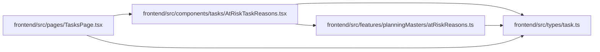

# AtRiskTaskReasons Module

**Path:** `frontend/src/components/tasks/AtRiskTaskReasons.tsx`

## Description

_Auto-generated from `frontend/src/components/tasks/AtRiskTaskReasons.tsx`._

## Imports

| Source | Symbols | Type-only | Runtime emission |
|--------|---------|-----------|------------------|
| `../../features/planningMasters/atRiskReasons` | `atRiskReasons` | — | compiler-dependent |
| `../../types/task` | `Task` | Declaration | erased |
| `react-i18next` | `useTranslation` | — | compiler-dependent |

## Module Signals

| Signal | Values |
|--------|--------|
| Exports | `AtRiskTaskReasons` |

## Local dependency map

<!-- Auto-generated local dependency summary. Do not edit by hand. -->
This graph shows full source coupling. Type dependencies can be erased; compiler-dependent cycle groups are runtime candidates, not confirmed initialization cycles.

### Internal neighbors

| Direction | Module |
|---|---|
| Inbound | [TasksPage](../modules/TasksPage.md) |
| Outbound | [atRiskReasons](../modules/atRiskReasons.md) |
| Outbound | [types_task](../modules/types_task.md) |

### External packages

| Language | Used packages | Undeclared packages |
|---|---:|---:|
| typescript | 1 | 0 |

## Functions

| Function | Signature | Decorators | Description |
|----------|-----------|------------|-------------|
| `AtRiskTaskReasons` | `({ task }: { task: Task })` | — | The reasons an opened task is at risk, shown while the Tasks list is filtered to at-risk work. |
