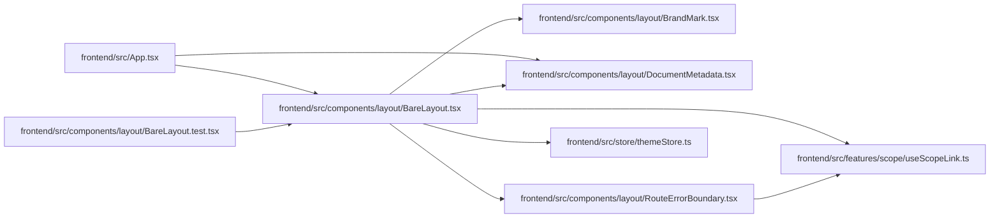

# BareLayout Module

**Path:** `frontend/src/components/layout/BareLayout.tsx`

## Description

_Auto-generated from `frontend/src/components/layout/BareLayout.tsx`._

## Imports

| Source | Symbols | Type-only | Runtime emission |
|--------|---------|-----------|------------------|
| `../../features/scope/useScopeLink` | `useScopeLink` | — | compiler-dependent |
| `../../store/themeStore` | `useThemeStore` | — | compiler-dependent |
| `./BrandMark` | `BrandMark` | — | compiler-dependent |
| `./DocumentMetadata` | `DocumentMetadata` | — | compiler-dependent |
| `./RouteErrorBoundary` | `RouteErrorBoundary` | — | compiler-dependent |
| `react` | `ReactNode` | Specifier | compiler-dependent |
| `react` | `useEffect` | — | compiler-dependent |
| `react-i18next` | `useTranslation` | — | compiler-dependent |
| `react-router-dom` | `Link`, `useLocation` | — | compiler-dependent |

## Module Signals

| Signal | Values |
|--------|--------|
| Exports | `BareLayout` |

## Local dependency map

<!-- Auto-generated local dependency summary. Do not edit by hand. -->

### Internal neighbors

| Direction | Module |
|---|---|
| Inbound | [App](../modules/App.md) |
| Inbound | [BareLayout.test](../modules/BareLayout.test.md) |
| Outbound | [BrandMark](../modules/BrandMark.md) |
| Outbound | [DocumentMetadata](../modules/DocumentMetadata.md) |
| Outbound | [RouteErrorBoundary](../modules/RouteErrorBoundary.md) |
| Outbound | [useScopeLink](../modules/useScopeLink.md) |
| Outbound | [themeStore](../modules/themeStore.md) |

### External packages

| Language | Used packages | Undeclared packages |
|---|---:|---:|
| typescript | 3 | 0 |

## Functions

| Function | Signature | Decorators | Description |
|----------|-----------|------------|-------------|
| `BareLayout` | `({ children }: { children: ReactNode })` | — | — |
