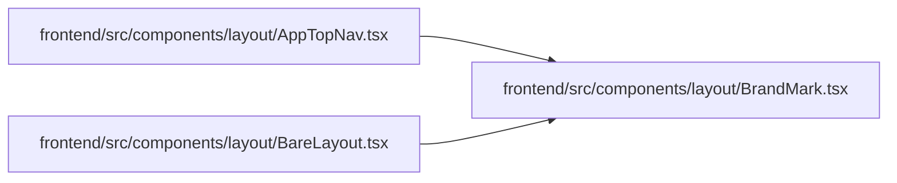

# BrandMark Module

**Path:** `frontend/src/components/layout/BrandMark.tsx`

## Description

/**
 * WorkChord logo for the top bar: one ring crossed by a chord of hexagon
 * cells. It is the same drawing as `public/favicon.svg`, so the header and
 * the browser tab show the same mark.
 */

## Module Signals

| Signal | Values |
|--------|--------|
| Exports | `BrandMark` |

## Local dependency map

<!-- Auto-generated local dependency summary. Do not edit by hand. -->

### Internal neighbors

| Direction | Module |
|---|---|
| Inbound | [AppTopNav](../modules/AppTopNav.md) |
| Inbound | [BareLayout](../modules/BareLayout.md) |

## Functions

| Function | Signature | Decorators | Description |
|----------|-----------|------------|-------------|
| `BrandMark` | `()` | — | WorkChord logo for the top bar: one ring crossed by a chord of hexagon |
