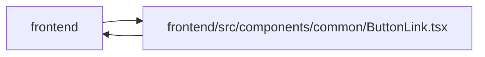

# ButtonLink Module

**Path:** `frontend/src/components/common/ButtonLink.tsx`

## Description

_Auto-generated from `frontend/src/components/common/ButtonLink.tsx`._

## Imports

| Source | Symbols | Type-only | Runtime emission |
|--------|---------|-----------|------------------|
| `./buttonStyles` | `ButtonSize`, `ButtonVariant` | Specifier | compiler-dependent |
| `./buttonStyles` | `buttonClassName` | — | compiler-dependent |
| `react` | `ReactNode` | Declaration | erased |
| `react` | `forwardRef` | — | compiler-dependent |
| `react-router-dom` | `LinkProps` | Declaration | erased |
| `react-router-dom` | `Link` | — | compiler-dependent |

## Module Signals

| Signal | Values |
|--------|--------|
| Exports | `ButtonLink` |
| Constants | `ButtonLink` |
| Module calls | `ButtonLink = forwardRef` |

## Local dependency map

<!-- Auto-generated local dependency summary. Do not edit by hand. -->
This graph shows full source coupling. Type dependencies can be erased; compiler-dependent cycle groups are runtime candidates, not confirmed initialization cycles.

> Module-level dependencies exceed the generated-diagram limits, so the diagram and table below group them by top-level package. Counts report the number of module neighbors in each package.

### Internal neighbors

| Direction | Module |
|---|---|
| Inbound | `frontend` (23) |
| Outbound | `frontend` (1) |

### External packages

| Language | Used packages | Undeclared packages |
|---|---:|---:|
| typescript | 2 | 0 |

> All 24 module neighbor(s) are summarized by package because the module-level view exceeds the 12-node limit.

## Classes

| Class | Kind | Line | Bases / Target | Description |
|-------|------|------|----------------|-------------|
| [ButtonLinkProps](../entities/ButtonLinkProps.md) | Type alias | 7 | <pre><code>Omit&#60;LinkProps&#44; &#39;className&#39; &#124; &#39;children&#39;&#62; &#38; &#123;&#10;    variant&#63;&#58; ButtonVariant&#59;&#10;    size&#63;&#58; ButtonSize&#59;&#10;    className&#63;&#58; string&#59;&#10;    children&#58; ReactNode&#59;&#10;&#125;</code></pre> | — |
