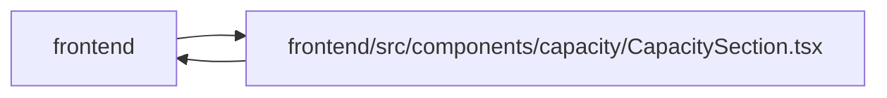

# CapacitySection Module

**Path:** `frontend/src/components/capacity/CapacitySection.tsx`

## Description

_Auto-generated from `frontend/src/components/capacity/CapacitySection.tsx`._

## Imports

| Source | Symbols | Type-only | Runtime emission |
|--------|---------|-----------|------------------|
| `../../features/identity/identityContext` | `useIdentity` | — | compiler-dependent |
| `../../services/teamService` | `teamService` | — | compiler-dependent |
| `../../types/iteration` | `Iteration` | Declaration | erased |
| `../../types/team` | `TeamMember` | Declaration | erased |
| `../../utils/apiError` | `getApiErrorMessage` | — | compiler-dependent |
| `../common/Button` | `Button` | — | compiler-dependent |
| `../team/ConnectAgentSteps` | `ConnectAgentSteps` | — | compiler-dependent |
| `../team/ImportTeamModal` | `ImportTeamModal` | — | compiler-dependent |
| `../team/VacationCsvImport` | `VacationCsvImport` | — | compiler-dependent |
| `../ui/OverflowMenu` | `OverflowMenu` | — | compiler-dependent |
| `../ui/SlideOverDrawer` | `SlideOverDrawer` | — | compiler-dependent |
| `./PlanQuickAddCapacity` | `PlanQuickAddCapacity` | — | compiler-dependent |
| `./TeamForm` | `TeamForm` | — | compiler-dependent |
| `./TeamList` | `TeamList` | — | compiler-dependent |
| `./capacityMutations` | `addCapacityRows`, `refreshCapacity` | — | compiler-dependent |
| `@tanstack/react-query` | `useMutation`, `useQueryClient` | — | compiler-dependent |
| `react` | `useState` | — | compiler-dependent |
| `react-i18next` | `useTranslation` | — | compiler-dependent |
| `react-router-dom` | `useSearchParams` | — | compiler-dependent |

## Module Signals

| Signal | Values |
|--------|--------|
| Exports | `CapacitySection` |
| Constants | `CONNECT_PARAM` |

## Local dependency map

<!-- Auto-generated local dependency summary. Do not edit by hand. -->
This graph shows full source coupling. Type dependencies can be erased; compiler-dependent cycle groups are runtime candidates, not confirmed initialization cycles.

> Module-level dependencies exceed the generated-diagram limits, so the diagram and table below group them by top-level package. Counts report the number of module neighbors in each package.

### Internal neighbors

| Direction | Module |
|---|---|
| Inbound | `frontend` (2) |
| Outbound | `frontend` (15) |

### External packages

| Language | Used packages | Undeclared packages |
|---|---:|---:|
| typescript | 4 | 0 |

> All 17 module neighbor(s) are summarized by package because the module-level view exceeds the 12-node limit.

## Functions

| Function | Signature | Decorators | Description |
|----------|-----------|------------|-------------|
| `CapacitySection` | <pre><code>&#40;&#123; iteration&#44; iterations&#44; members&#44; primary &#125;&#58; &#123;&#10;    iteration&#58; Iteration&#59; iterations&#58; Iteration&#91;&#93;&#59; members&#58; TeamMember&#91;&#93;&#59; primary&#58; boolean&#59;&#10;&#125;&#41;</code></pre> | — | — |
