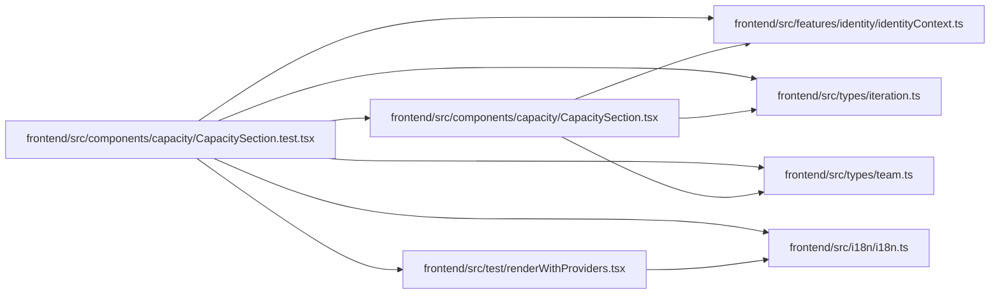

# CapacitySection.test Module

**Path:** `frontend/src/components/capacity/CapacitySection.test.tsx`

## Description

_Auto-generated from `frontend/src/components/capacity/CapacitySection.test.tsx`._

## Imports

| Source | Symbols | Type-only | Runtime emission |
|--------|---------|-----------|------------------|
| `../../features/identity/identityContext` | `IdentityContext` | — | compiler-dependent |
| `../../i18n/i18n` | `i18n` | — | compiler-dependent |
| `../../test/renderWithProviders` | `renderWithProviders` | — | compiler-dependent |
| `../../types/iteration` | `Iteration` | Declaration | erased |
| `../../types/team` | `TeamMember` | Declaration | erased |
| `./CapacitySection` | `CapacitySection` | — | compiler-dependent |
| `@testing-library/react` | `screen`, `waitFor` | — | compiler-dependent |
| `react` | `ReactElement` | Declaration | erased |
| `react-router-dom` | `useLocation` | — | compiler-dependent |
| `vitest` | `it`, `expect`, `vi` | — | compiler-dependent |

## Module Signals

| Signal | Values |
|--------|--------|
| Constants | `capacityApi` |
| Module calls | `mock`, `mock`, `mock`, `it`, `capacityApi = hoisted`, `mock`, `mock`, `mock`, `it`, `it`, `it` |

## Local dependency map

<!-- Auto-generated local dependency summary. Do not edit by hand. -->
This graph shows full source coupling. Type dependencies can be erased; compiler-dependent cycle groups are runtime candidates, not confirmed initialization cycles.

### Internal neighbors

| Direction | Module |
|---|---|
| Outbound | [CapacitySection](../modules/CapacitySection.md) |
| Outbound | [identityContext](../modules/identityContext.md) |
| Outbound | [i18n](../modules/i18n.md) |
| Outbound | [renderWithProviders](../modules/renderWithProviders.md) |
| Outbound | [types_iteration](../modules/types_iteration.md) |
| Outbound | [types_team](../modules/types_team.md) |

### External packages

| Language | Used packages | Undeclared packages |
|---|---:|---:|
| typescript | 4 | 0 |
