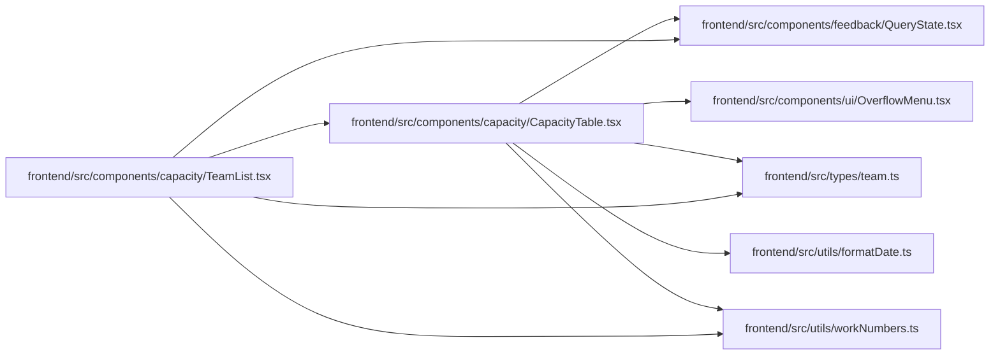

# CapacityTable Module

**Path:** `frontend/src/components/capacity/CapacityTable.tsx`

## Description

_Auto-generated from `frontend/src/components/capacity/CapacityTable.tsx`._

## Imports

| Source | Symbols | Type-only | Runtime emission |
|--------|---------|-----------|------------------|
| `../../types/team` | `MemberWorkload`, `TeamMember` | Declaration | erased |
| `../../utils/formatDate` | `formatDate` | — | compiler-dependent |
| `../../utils/workNumbers` | `formatDecimal` | — | compiler-dependent |
| `../feedback/QueryState` | `QueryErrorState` | — | compiler-dependent |
| `../ui/OverflowMenu` | `OverflowMenu` | — | compiler-dependent |
| `@tanstack/react-query` | `UseQueryResult` | Declaration | erased |
| `lucide-react` | `Bot`, `User` | — | compiler-dependent |
| `react-i18next` | `useTranslation` | — | compiler-dependent |

## Module Signals

| Signal | Values |
|--------|--------|
| Exports | `CapacityTable` |

## Local dependency map

<!-- Auto-generated local dependency summary. Do not edit by hand. -->
This graph shows full source coupling. Type dependencies can be erased; compiler-dependent cycle groups are runtime candidates, not confirmed initialization cycles.

### Internal neighbors

| Direction | Module |
|---|---|
| Inbound | [TeamList](../modules/TeamList.md) |
| Outbound | [QueryState](../modules/QueryState.md) |
| Outbound | [OverflowMenu](../modules/OverflowMenu.md) |
| Outbound | [types_team](../modules/types_team.md) |
| Outbound | [formatDate](../modules/formatDate.md) |
| Outbound | [workNumbers](../modules/workNumbers.md) |

### External packages

| Language | Used packages | Undeclared packages |
|---|---:|---:|
| typescript | 3 | 0 |

## Functions

| Function | Signature | Decorators | Description |
|----------|-----------|------------|-------------|
| `CapacityTable` | <pre><code>&#40;&#123; members&#44; workloads&#44; onEdit&#44; onTimeOff&#44; onRemove&#44; removing &#125;&#58; &#123;&#10;    members&#58; TeamMember&#91;&#93;&#59; workloads&#58; UseQueryResult&#60;MemberWorkload&#62;&#91;&#93;&#59;&#10;    onEdit&#58; &#40;member&#58; TeamMember&#41; &#61;&#62; void&#59; onTimeOff&#58; &#40;id&#58; number&#41; &#61;&#62; void&#59;&#10;    onRemove&#58; &#40;member&#58; TeamMember&#41; &#61;&#62; void&#59; removing&#58; boolean&#59;&#10;&#125;&#41;</code></pre> | — | — |
