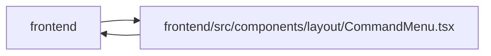

# CommandMenu Module

**Path:** `frontend/src/components/layout/CommandMenu.tsx`

## Description

_Auto-generated from `frontend/src/components/layout/CommandMenu.tsx`._

## Imports

| Source | Symbols | Type-only | Runtime emission |
|--------|---------|-----------|------------------|
| `../../hooks/useSingleKeyShortcutPreference` | `useSingleKeyShortcutPreference` | — | compiler-dependent |
| `../../i18n/seedDisplay` | `savedViewDisplay` | — | compiler-dependent |
| `../../navigation/workspaces` | `getWorkspaceForPath`, `WORKSPACES` | — | compiler-dependent |
| `../../services/projectService` | `projectService` | — | compiler-dependent |
| `../../services/savedViewService` | `savedViewService` | — | compiler-dependent |
| `../../services/taskService` | `taskService` | — | compiler-dependent |
| `../../types/savedView` | `SavedView` | Declaration | erased |
| `../common/Checkbox` | `Checkbox` | — | compiler-dependent |
| `../common/Modal` | `Modal` | — | compiler-dependent |
| `./commandMenuEvents` | `OPEN_COMMAND_MENU_EVENT` | — | compiler-dependent |
| `@tanstack/react-query` | `useQuery` | — | compiler-dependent |
| `lucide-react` | `LucideIcon` | Declaration | erased |
| `lucide-react` | `ArrowUpDown`, `Bookmark`, `ClipboardCheck`, `FolderOpen`, `Command`, `Layers`, `List`, `LayoutGrid`, `ListFilter`, `ListTodo`, `MapPin`, `Maximize2`, `Minimize2`, `Plus`, `Search` | — | compiler-dependent |
| `react` | `KeyboardEvent` | Declaration | erased |
| `react` | `useCallback`, `useEffect`, `useMemo`, `useRef`, `useState` | — | compiler-dependent |
| `react-i18next` | `useTranslation` | — | compiler-dependent |
| `react-router-dom` | `useLocation`, `useNavigate` | — | compiler-dependent |

## Module Signals

| Signal | Values |
|--------|--------|
| Exports | `CommandMenu`, `RECENT_COMMANDS_STORAGE_KEY` |
| Constants | `NAV_COMMAND_IDS`, `NAV_COMMAND_KEYS`, `MAX_ENTITY_RESULTS`, `SAVED_VIEW_TYPES`, `TASKS_FIRST_GROUPS`, `CURRENT_FIRST_GROUPS`, `COMPACT_GROUPS`, `MAX_COMPACT_SUGGESTIONS`, `MAX_RECENT_COMMANDS`, `RECENT_COMMANDS_STORAGE_KEY`, `WORKSPACE_SUGGESTION_IDS` |

## Local dependency map

<!-- Auto-generated local dependency summary. Do not edit by hand. -->
This graph shows full source coupling. Type dependencies can be erased; compiler-dependent cycle groups are runtime candidates, not confirmed initialization cycles.

> Module-level dependencies exceed the generated-diagram limits, so the diagram and table below group them by top-level package. Counts report the number of module neighbors in each package.

### Internal neighbors

| Direction | Module |
|---|---|
| Inbound | `frontend` (3) |
| Outbound | `frontend` (10) |

### External packages

| Language | Used packages | Undeclared packages |
|---|---:|---:|
| typescript | 5 | 0 |

> All 13 module neighbor(s) are summarized by package because the module-level view exceeds the 12-node limit.

## Classes

| Class | Kind | Line | Bases / Target | Description |
|-------|------|------|----------------|-------------|
| [CommandAction](../entities/CommandAction.md) | Interface | 37 | — | — |
| [CommandGroup](../entities/CommandGroup.md) | Type alias | 35 | `'results' \| 'tasks' \| 'current' \| 'navigate' \| 'suggested'` | — |

## Functions

| Function | Signature | Decorators | Description |
|----------|-----------|------------|-------------|
| `CommandMenu` | `()` | — | — |
