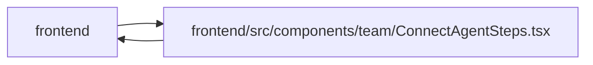

# ConnectAgentSteps Module

**Path:** `frontend/src/components/team/ConnectAgentSteps.tsx`

## Description

The Connect tab reads the current topology before offering a setup step. The operator reviews a plan before applying it. After an apply, the tab refreshes status while agents acknowledge their packages. A configured member and a runtime-ready member are separate states.

## Imports

| Source | Symbols | Type-only | Runtime emission |
|--------|---------|-----------|------------------|
| `../../features/agentTeamSetup/connectAgent` | `AgentRuntime`, `ConnectIssue` | Specifier | compiler-dependent |
| `../../features/agentTeamSetup/connectAgent` | `AGENT_RUNTIMES`, `CONNECT_STEPS`, `RUNTIME_PRODUCT_NAMES`, `STEP_INDEX`, `applyOutcomeUnknown`, `buildConnectedMember`, `connectIssue`, `hasPM`, `isConnected`, `replacesPendingPM`, `waitingMembers` | — | compiler-dependent |
| `../../features/agentTeamSetup/manifest` | `assertAgentTeamMasterSecretFree` | — | compiler-dependent |
| `../../hooks/useAdminAccess` | `useAdminAccess` | — | compiler-dependent |
| `../../services/agentService` | `agentService` | — | compiler-dependent |
| `../../services/teamService` | `teamService` | — | compiler-dependent |
| `../../types/agent` | `AgentModelCatalogCreate`, `AgentTeamMaster`, `AgentTeamMemberSpec`, `AgentTeamPlan`, `AgentTeamRole` | Declaration | erased |
| `../../utils/modelRouting` | `createAgentCommandMetadata` | — | compiler-dependent |
| `../common/Button` | `Button` | — | compiler-dependent |
| `../common/Input` | `Input` | — | compiler-dependent |
| `../common/Select` | `Select` | — | compiler-dependent |
| `../settings/AdminAccessPanel` | `AdminAccessPanel` | — | compiler-dependent |
| `../settings/sharedUnlock` | `SharedUnlockContext` | — | compiler-dependent |
| `../ui/InlineEmptyState` | `InlineEmptyState` | — | compiler-dependent |
| `../ui/SlideOverDrawer` | `SlideOverDrawer` | — | compiler-dependent |
| `./AgentManifestWorkflow` | `AgentManifestWorkflow` | — | compiler-dependent |
| `./ConnectionSteps` | `ConnectionSteps` | — | compiler-dependent |
| `@tanstack/react-query` | `useQuery` | — | compiler-dependent |
| `axios` | `axios` | — | compiler-dependent |
| `react` | `useEffect`, `useRef`, `useState` | — | compiler-dependent |
| `react-i18next` | `useTranslation` | — | compiler-dependent |

## Module Signals

| Signal | Values |
|--------|--------|
| Exports | `ConnectAgentSteps` |
| Constants | `emptyModel`, `tierOptions`, `tierLabels`, `P`, `MODEL_ERROR_MESSAGES`, `SETUP_GUIDE_URL` |

## Local dependency map

<!-- Auto-generated local dependency summary. Do not edit by hand. -->
This graph shows full source coupling. Type dependencies can be erased; compiler-dependent cycle groups are runtime candidates, not confirmed initialization cycles.

> Module-level dependencies exceed the generated-diagram limits, so the diagram and table below group them by top-level package. Counts report the number of module neighbors in each package.

### Internal neighbors

| Direction | Module |
|---|---|
| Inbound | `frontend` (3) |
| Outbound | `frontend` (16) |

### External packages

| Language | Used packages | Undeclared packages |
|---|---:|---:|
| typescript | 4 | 0 |

> All 19 module neighbor(s) are summarized by package because the module-level view exceeds the 12-node limit.

## Classes

| Class | Kind | Line | Bases / Target | Description |
|-------|------|------|----------------|-------------|
| [Candidate](../entities/ConnectAgentSteps_Candidate.md) | Type alias | 26 | `{ manifest: AgentTeamMaster; member: AgentTeamMemberSpec; plan?: AgentTeamPlan }` | A member the Connect steps are working on. A resumed member has no plan: it already exists and only waits for its runtime. |
| [ModelErrorKind](../entities/ModelErrorKind.md) | Type alias | 35 | `'refused' \| 'input' \| 'unavailable'` | — |

## Functions

| Function | Signature | Decorators | Description |
|----------|-----------|------------|-------------|
| `ConnectAgentSteps` | `({ showTitle = true }: { showTitle?: boolean })` | — | — |
