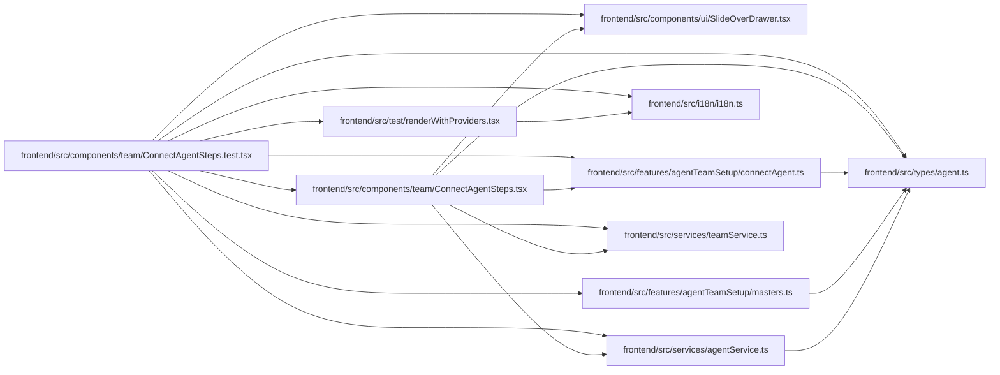

# ConnectAgentSteps.test Module

**Path:** `frontend/src/components/team/ConnectAgentSteps.test.tsx`

## Description

_Auto-generated from `frontend/src/components/team/ConnectAgentSteps.test.tsx`._

## Imports

| Source | Symbols | Type-only | Runtime emission |
|--------|---------|-----------|------------------|
| `../../features/agentTeamSetup/connectAgent` | `hasPM`, `runtimeSnippet` | — | compiler-dependent |
| `../../features/agentTeamSetup/masters` | `AGENT_TEAM_STEP_DEFINITIONS` | — | compiler-dependent |
| `../../i18n/i18n` | `i18n` | — | compiler-dependent |
| `../../services/agentService` | `agentService` | — | compiler-dependent |
| `../../services/teamService` | `teamService` | — | compiler-dependent |
| `../../test/renderWithProviders` | `renderWithProviders` | — | compiler-dependent |
| `../../types/agent` | `AgentModelCatalogEntry`, `AgentTeamMaster`, `AgentTeamMemberSpec`, `AgentTeamMemberStatus`, `AgentTeamPlan`, `AgentTeamStatus` | Declaration | erased |
| `../ui/SlideOverDrawer` | `SlideOverDrawer` | — | compiler-dependent |
| `./ConnectAgentSteps` | `ConnectAgentSteps` | — | compiler-dependent |
| `@testing-library/react` | `fireEvent`, `screen`, `waitFor`, `within` | — | compiler-dependent |
| `axios` | `AxiosError` | — | compiler-dependent |
| `node:crypto` | `createHash` | — | compiler-dependent |
| `vitest` | `afterEach`, `beforeEach`, `describe`, `expect`, `it`, `vi` | — | compiler-dependent |

## Module Signals

| Signal | Values |
|--------|--------|
| Constants | `service`, `teams`, `current`, `status`, `model` |
| Module calls | `mock`, `mock`, `mock`, `service = mocked`, `teams = mocked`, `beforeEach`, `afterEach`, `describe` |

## Local dependency map

<!-- Auto-generated local dependency summary. Do not edit by hand. -->
This graph shows full source coupling. Type dependencies can be erased; compiler-dependent cycle groups are runtime candidates, not confirmed initialization cycles.

### Internal neighbors

| Direction | Module |
|---|---|
| Outbound | [ConnectAgentSteps](../modules/ConnectAgentSteps.md) |
| Outbound | [SlideOverDrawer](../modules/SlideOverDrawer.md) |
| Outbound | [connectAgent](../modules/connectAgent.md) |
| Outbound | [agentTeamSetup_masters](../modules/agentTeamSetup_masters.md) |
| Outbound | [i18n](../modules/i18n.md) |
| Outbound | [agentService](../modules/agentService.md) |
| Outbound | [teamService](../modules/teamService.md) |
| Outbound | [renderWithProviders](../modules/renderWithProviders.md) |
| Outbound | [types_agent](../modules/types_agent.md) |

### External packages

| Language | Used packages | Undeclared packages |
|---|---:|---:|
| typescript | 3 | 0 |
