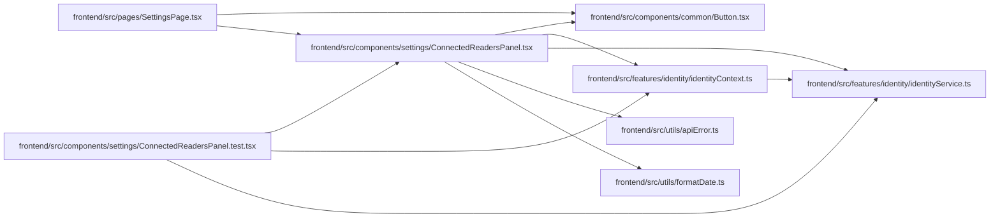

# ConnectedReadersPanel Module

**Path:** `frontend/src/components/settings/ConnectedReadersPanel.tsx`

## Description

Settings panel that lists the read-only observers paired with the signed-in account, or with a trusted-local workspace, and revokes them. It stays hidden for observers and for signed-out managed browsers.

## Imports

| Source | Symbols | Type-only | Runtime emission |
|--------|---------|-----------|------------------|
| `../../features/identity/identityContext` | `useIdentity` | — | compiler-dependent |
| `../../features/identity/identityService` | `AccountSession` | Specifier | compiler-dependent |
| `../../features/identity/identityService` | `identityService` | — | compiler-dependent |
| `../../utils/apiError` | `getApiErrorMessage` | — | compiler-dependent |
| `../../utils/formatDate` | `formatDateTime` | — | compiler-dependent |
| `../common/Button` | `Button` | — | compiler-dependent |
| `@tanstack/react-query` | `useMutation`, `useQuery`, `useQueryClient` | — | compiler-dependent |
| `react` | `useState` | — | compiler-dependent |
| `react-i18next` | `useTranslation` | — | compiler-dependent |

## Module Signals

| Signal | Values |
|--------|--------|
| Exports | `ConnectedReadersPanel` |

## Local dependency map

<!-- Auto-generated local dependency summary. Do not edit by hand. -->
This graph shows full source coupling. Type dependencies can be erased; compiler-dependent cycle groups are runtime candidates, not confirmed initialization cycles.

### Internal neighbors

| Direction | Module |
|---|---|
| Inbound | [ConnectedReadersPanel.test](../modules/ConnectedReadersPanel.test.md) |
| Inbound | [SettingsPage](../modules/SettingsPage.md) |
| Outbound | [Button](../modules/Button.md) |
| Outbound | [identityContext](../modules/identityContext.md) |
| Outbound | [identityService](../modules/identityService.md) |
| Outbound | [apiError](../modules/apiError.md) |
| Outbound | [formatDate](../modules/formatDate.md) |

### External packages

| Language | Used packages | Undeclared packages |
|---|---:|---:|
| typescript | 3 | 0 |

## Functions

| Function | Signature | Decorators | Description |
|----------|-----------|------------|-------------|
| `ConnectedReadersPanel` | `()` | — | Read-only readers paired with this account, or with a trusted-local workspace; each can be revoked. |
