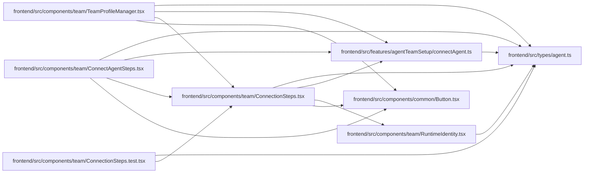

# ConnectionSteps Module

**Path:** `frontend/src/components/team/ConnectionSteps.tsx`

## Description

_Auto-generated from `frontend/src/components/team/ConnectionSteps.tsx`._

## Imports

| Source | Symbols | Type-only | Runtime emission |
|--------|---------|-----------|------------------|
| `../../features/agentTeamSetup/connectAgent` | `RUNTIME_PRODUCT_NAMES`, `credentialFilename`, `runtimeOfMember`, `runtimeSnippet` | — | compiler-dependent |
| `../../types/agent` | `AgentTeamMaster`, `AgentTeamMemberSpec`, `AgentTeamMemberStatus` | Declaration | erased |
| `../common/Button` | `Button` | — | compiler-dependent |
| `./RuntimeIdentity` | `RuntimeIdentity` | — | compiler-dependent |
| `react` | `useEffect`, `useState` | — | compiler-dependent |
| `react-i18next` | `useTranslation` | — | compiler-dependent |

## Module Signals

| Signal | Values |
|--------|--------|
| Exports | `ConnectionSteps` |
| Constants | `P` |

## Local dependency map

<!-- Auto-generated local dependency summary. Do not edit by hand. -->
This graph shows full source coupling. Type dependencies can be erased; compiler-dependent cycle groups are runtime candidates, not confirmed initialization cycles.

### Internal neighbors

| Direction | Module |
|---|---|
| Inbound | [ConnectAgentSteps](../modules/ConnectAgentSteps.md) |
| Inbound | [ConnectionSteps.test](../modules/ConnectionSteps.test.md) |
| Inbound | [TeamProfileManager](../modules/TeamProfileManager.md) |
| Outbound | [Button](../modules/Button.md) |
| Outbound | [RuntimeIdentity](../modules/RuntimeIdentity.md) |
| Outbound | [connectAgent](../modules/connectAgent.md) |
| Outbound | [types_agent](../modules/types_agent.md) |

### External packages

| Language | Used packages | Undeclared packages |
|---|---:|---:|
| typescript | 2 | 0 |

## Functions

| Function | Signature | Decorators | Description |
|----------|-----------|------------|-------------|
| `ConnectionSteps` | <pre><code>&#40;&#123; manifest&#44; member&#44; memberStatus&#44; connected&#44; checking &#61; false&#44; onCheck &#125;&#58; &#123;&#10;    manifest&#58; AgentTeamMaster&#59;&#10;    member&#58; AgentTeamMemberSpec&#59;&#10;    memberStatus&#58; AgentTeamMemberStatus &#124; undefined&#59;&#10;    connected&#58; boolean&#59;&#10;    checking&#63;&#58; boolean&#59;&#10;    onCheck&#58; &#40;&#41; &#61;&#62; void&#59;&#10;&#125;&#41;</code></pre> | — | What the Connect steps show once a member exists: the credential file, the skill package, the runtime |
