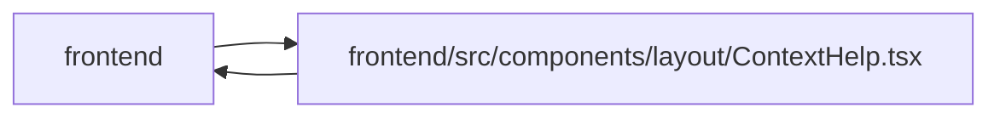

# ContextHelp Module

**Path:** `frontend/src/components/layout/ContextHelp.tsx`

## Description

_Auto-generated from `frontend/src/components/layout/ContextHelp.tsx`._

## Imports

| Source | Symbols | Type-only | Runtime emission |
|--------|---------|-----------|------------------|
| `../../components/common/Button` | `Button` | — | compiler-dependent |
| `../../features/scope/useScopeLink` | `useScopeLink` | — | compiler-dependent |
| `../../hooks/useSingleKeyShortcutPreference` | `useSingleKeyShortcutPreference` | — | compiler-dependent |
| `../../navigation/helpContexts` | `WorkflowGuideKey` | Specifier | compiler-dependent |
| `../../navigation/helpContexts` | `getHelpContext` | — | compiler-dependent |
| `../common/Checkbox` | `Checkbox` | — | compiler-dependent |
| `../planning/PlanningWorkflowHelpContent` | `PlanningWorkflowHelpContent` | — | compiler-dependent |
| `../settings/SettingsGoalHelpContent` | `SettingsGoalHelpContent` | — | compiler-dependent |
| `../tasks/TaskWorkflowHelpContent` | `TaskWorkflowHelpContent` | — | compiler-dependent |
| `../ui` | `SlideOverDrawer` | — | compiler-dependent |
| `./commandMenuEvents` | `openCommandMenu` | — | compiler-dependent |
| `./setupGuideEvents` | `openSetupGuide` | — | compiler-dependent |
| `lucide-react` | `ArrowDownUp`, `ChevronRight`, `CircleHelp`, `Command`, `CornerDownLeft`, `Keyboard` | — | compiler-dependent |
| `react` | `useId`, `useState` | — | compiler-dependent |
| `react-i18next` | `useTranslation` | — | compiler-dependent |
| `react-router-dom` | `Link`, `useLocation` | — | compiler-dependent |

## Module Signals

| Signal | Values |
|--------|--------|
| Exports | `ContextHelp` |
| Constants | `TASK_SHORTCUTS` |

## Local dependency map

<!-- Auto-generated local dependency summary. Do not edit by hand. -->
This graph shows full source coupling. Type dependencies can be erased; compiler-dependent cycle groups are runtime candidates, not confirmed initialization cycles.

> Module-level dependencies exceed the generated-diagram limits, so the diagram and table below group them by top-level package. Counts report the number of module neighbors in each package.

### Internal neighbors

| Direction | Module |
|---|---|
| Inbound | `frontend` (3) |
| Outbound | `frontend` (11) |

### External packages

| Language | Used packages | Undeclared packages |
|---|---:|---:|
| typescript | 4 | 0 |

> All 14 module neighbor(s) are summarized by package because the module-level view exceeds the 12-node limit.

## Functions

| Function | Signature | Decorators | Description |
|----------|-----------|------------|-------------|
| `ContextHelp` | `()` | — | — |
