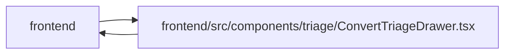

# ConvertTriageDrawer Module

**Path:** `frontend/src/components/triage/ConvertTriageDrawer.tsx`

## Description

_Auto-generated from `frontend/src/components/triage/ConvertTriageDrawer.tsx`._

## Imports

| Source | Symbols | Type-only | Runtime emission |
|--------|---------|-----------|------------------|
| `../../i18n/seedDisplay` | `templateDisplay` | — | compiler-dependent |
| `../../services/teamService` | `teamService` | — | compiler-dependent |
| `../../services/templateService` | `templateService` | — | compiler-dependent |
| `../../services/triageService` | `triageService` | — | compiler-dependent |
| `../../types/iteration` | `Iteration` | Declaration | erased |
| `../../types/project` | `Project` | Declaration | erased |
| `../../types/team` | `TeamMember` | Declaration | erased |
| `../../types/triage` | `TriageConvertToTaskRequest`, `TriageItem`, `TriageTaskDraftResponse` | Declaration | erased |
| `../../utils/apiError` | `getApiErrorMessage` | — | compiler-dependent |
| `../common/Button` | `Button` | — | compiler-dependent |
| `../common/CollapsibleSection` | `CollapsibleSection` | — | compiler-dependent |
| `../common/Input` | `Input`, `RequiredIndicator` | — | compiler-dependent |
| `../common/Select` | `Select` | — | compiler-dependent |
| `../feedback/QueryState` | `QueryErrorState` | — | compiler-dependent |
| `../labels/LabelSelector` | `LabelSelector` | — | compiler-dependent |
| `../tasks/TaskBriefEditor` | `TaskBriefEditor` | — | compiler-dependent |
| `../tasks/TaskCreateSections` | `TaskCreateSections` | — | compiler-dependent |
| `../tasks/TaskDependencySelector` | `TaskDependencySelector` | — | compiler-dependent |
| `../tasks/taskEditorContract` | `emptyTaskBrief`, `newCriterion` | — | compiler-dependent |
| `../team/AssigneeRecommendationsPanel` | `AssigneeRecommendationsPanel` | — | compiler-dependent |
| `../ui/SlideOverDrawer` | `SlideOverDrawer` | — | compiler-dependent |
| `./TriageConvertSource` | `TriageConvertSource` | — | compiler-dependent |
| `./TriageDraftPreview` | `TriageDraftPreview` | — | compiler-dependent |
| `./triageUtils` | `formatDraftDescription`, `makeLookup`, `optionalText`, `parseOptionalNumber` | — | compiler-dependent |
| `@tanstack/react-query` | `useMutation`, `useQuery` | — | compiler-dependent |
| `lucide-react` | `Send`, `Sparkles` | — | compiler-dependent |
| `react` | `FormEvent` | Declaration | erased |
| `react` | `useMemo`, `useState` | — | compiler-dependent |
| `react-i18next` | `useTranslation` | — | compiler-dependent |

## Module Signals

| Signal | Values |
|--------|--------|
| Exports | `ConvertTriageDrawer` |

## Local dependency map

<!-- Auto-generated local dependency summary. Do not edit by hand. -->
This graph shows full source coupling. Type dependencies can be erased; compiler-dependent cycle groups are runtime candidates, not confirmed initialization cycles.

> Module-level dependencies exceed the generated-diagram limits, so the diagram and table below group them by top-level package. Counts report the number of module neighbors in each package.

### Internal neighbors

| Direction | Module |
|---|---|
| Inbound | `frontend` (2) |
| Outbound | `frontend` (24) |

### External packages

| Language | Used packages | Undeclared packages |
|---|---:|---:|
| typescript | 4 | 0 |

> All 26 module neighbor(s) are summarized by package because the module-level view exceeds the 12-node limit.

## Classes

| Class | Kind | Line | Bases / Target | Description |
|-------|------|------|----------------|-------------|
| [ConvertTriageDrawerProps](../entities/ConvertTriageDrawerProps.md) | Interface | 38 | — | — |

## Functions

| Function | Signature | Decorators | Description |
|----------|-----------|------------|-------------|
| `ConvertTriageDrawer` | <pre><code>&#40;&#123;&#10;    item&#44;&#10;    projects&#44;&#10;    iterations&#44;&#10;    selectedIterationId&#44;&#10;    isSubmitting&#44;&#10;    error&#44;&#10;    onSubmit&#44;&#10;    onClose&#44;&#10;&#125;&#58; ConvertTriageDrawerProps&#41;</code></pre> | — | — |
