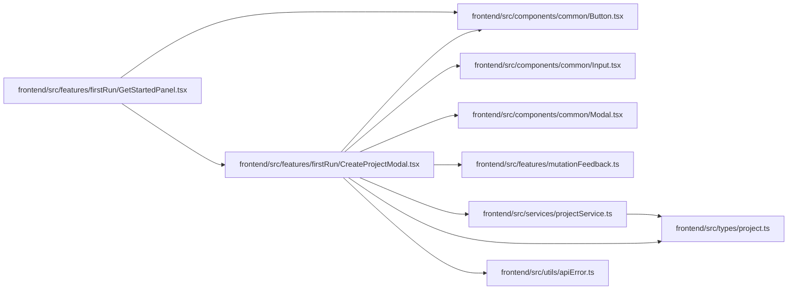

# CreateProjectModal Module

**Path:** `frontend/src/features/firstRun/CreateProjectModal.tsx`

## Description

_Auto-generated from `frontend/src/features/firstRun/CreateProjectModal.tsx`._

## Imports

| Source | Symbols | Type-only | Runtime emission |
|--------|---------|-----------|------------------|
| `../../components/common/Button` | `Button` | — | compiler-dependent |
| `../../components/common/Input` | `Input` | — | compiler-dependent |
| `../../components/common/Modal` | `Modal` | — | compiler-dependent |
| `../../services/projectService` | `projectService` | — | compiler-dependent |
| `../../types/project` | `Project` | Declaration | erased |
| `../../utils/apiError` | `getApiErrorMessage` | — | compiler-dependent |
| `../mutationFeedback` | `MutationFeedbackMeta` | Declaration | erased |
| `../mutationFeedback` | `feedbackMessage` | — | compiler-dependent |
| `@tanstack/react-query` | `useMutation`, `useQueryClient` | — | compiler-dependent |
| `react` | `FormEvent` | Declaration | erased |
| `react` | `useRef`, `useState` | — | compiler-dependent |
| `react-i18next` | `useTranslation` | — | compiler-dependent |

## Module Signals

| Signal | Values |
|--------|--------|
| Exports | `CreateProjectModal` |

## Local dependency map

<!-- Auto-generated local dependency summary. Do not edit by hand. -->
This graph shows full source coupling. Type dependencies can be erased; compiler-dependent cycle groups are runtime candidates, not confirmed initialization cycles.

### Internal neighbors

| Direction | Module |
|---|---|
| Inbound | [GetStartedPanel](../modules/GetStartedPanel.md) |
| Outbound | [Button](../modules/Button.md) |
| Outbound | [Input](../modules/Input.md) |
| Outbound | [Modal](../modules/Modal.md) |
| Outbound | [mutationFeedback](../modules/mutationFeedback.md) |
| Outbound | [projectService](../modules/projectService.md) |
| Outbound | [types_project](../modules/types_project.md) |
| Outbound | [apiError](../modules/apiError.md) |

### External packages

| Language | Used packages | Undeclared packages |
|---|---:|---:|
| typescript | 3 | 0 |

## Functions

| Function | Signature | Decorators | Description |
|----------|-----------|------------|-------------|
| `CreateProjectModal` | `({ onClose, onCreated }: { onClose: () => void; onCreated: (project: Project) => void })` | — | The short way to a first project: a name and, optionally, its start and target dates. |
