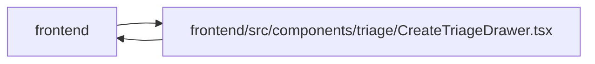

# CreateTriageDrawer Module

**Path:** `frontend/src/components/triage/CreateTriageDrawer.tsx`

## Description

_Auto-generated from `frontend/src/components/triage/CreateTriageDrawer.tsx`._

## Imports

| Source | Symbols | Type-only | Runtime emission |
|--------|---------|-----------|------------------|
| `../../i18n/seedDisplay` | `templateDisplay` | — | compiler-dependent |
| `../../services/templateService` | `templateService` | — | compiler-dependent |
| `../../types/iteration` | `Iteration` | Declaration | erased |
| `../../types/project` | `Project` | Declaration | erased |
| `../../types/template` | `WorkTemplate` | Declaration | erased |
| `../../types/triage` | `TriageItemCreate` | Declaration | erased |
| `../../utils/templateDefaults` | `appendChecklistToDescription`, `getPayloadString`, `mergeLabels` | — | compiler-dependent |
| `../common/Button` | `Button` | — | compiler-dependent |
| `../common/Input` | `Input` | — | compiler-dependent |
| `../common/Select` | `Select` | — | compiler-dependent |
| `../common/Textarea` | `Textarea` | — | compiler-dependent |
| `../feedback/QueryState` | `QueryErrorState` | — | compiler-dependent |
| `../labels/LabelSelector` | `LabelSelector` | — | compiler-dependent |
| `../ui/SlideOverDrawer` | `SlideOverDrawer` | — | compiler-dependent |
| `./triageUtils` | `optionalText`, `parseOptionalNumber`, `t` | — | compiler-dependent |
| `@tanstack/react-query` | `useQuery` | — | compiler-dependent |
| `lucide-react` | `AlertCircle`, `Plus` | — | compiler-dependent |
| `react` | `FormEvent` | Declaration | erased |
| `react` | `useState` | — | compiler-dependent |

## Module Signals

| Signal | Values |
|--------|--------|
| Exports | `CreateTriageDrawer` |

## Local dependency map

<!-- Auto-generated local dependency summary. Do not edit by hand. -->
This graph shows full source coupling. Type dependencies can be erased; compiler-dependent cycle groups are runtime candidates, not confirmed initialization cycles.

> Module-level dependencies exceed the generated-diagram limits, so the diagram and table below group them by top-level package. Counts report the number of module neighbors in each package.

### Internal neighbors

| Direction | Module |
|---|---|
| Inbound | `frontend` (1) |
| Outbound | `frontend` (15) |

### External packages

| Language | Used packages | Undeclared packages |
|---|---:|---:|
| typescript | 3 | 0 |

> All 16 module neighbor(s) are summarized by package because the module-level view exceeds the 12-node limit.

## Classes

| Class | Kind | Line | Bases / Target | Description |
|-------|------|------|----------------|-------------|
| [CreateTriageDrawerProps](../entities/CreateTriageDrawerProps.md) | Interface | 30 | — | — |

## Functions

| Function | Signature | Decorators | Description |
|----------|-----------|------------|-------------|
| `CreateTriageDrawer` | `({ projects, iterations, isSubmitting, error, sourceUrlError, onSubmit, onClose, initialTitle = '' }: CreateTriageDrawerProps)` | — | — |
