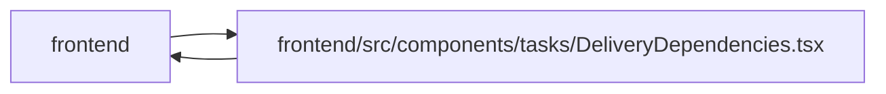

# DeliveryDependencies Module

**Path:** `frontend/src/components/tasks/DeliveryDependencies.tsx`

## Description

Displays delivery readiness and adds or removes typed prerequisites using the dependent task version. Task search and milestone choices are scoped; unavailable targets remain generic. Failed mutations preserve the current selection and expose reconciliation feedback.

## Imports

| Source | Symbols | Type-only | Runtime emission |
|--------|---------|-----------|------------------|
| `../../components/common/Select` | `Select` | — | compiler-dependent |
| `../../features/identity/useProjectEditAccess` | `PREREQUISITE_RETARGET_FEATURE`, `useProjectEditAccess` | — | compiler-dependent |
| `../../features/mutationFeedback` | `MutationFeedbackMeta` | Declaration | erased |
| `../../services/api` | `api` | — | compiler-dependent |
| `../../services/githubService` | `githubService` | — | compiler-dependent |
| `../../services/projectService` | `projectService` | — | compiler-dependent |
| `../../services/taskService` | `taskService` | — | compiler-dependent |
| `../../types/github` | `DeliveryPrerequisite` | Declaration | erased |
| `../../types/task` | `Task` | Declaration | erased |
| `../../utils/apiError` | `getApiErrorMessage`, `getApiErrorStatus` | — | compiler-dependent |
| `../common/Button` | `Button` | — | compiler-dependent |
| `../feedback/QueryState` | `QueryErrorState` | — | compiler-dependent |
| `./taskViewSession` | `TaskViewSession`, `TaskViewSessionUpdate` | Specifier | compiler-dependent |
| `./taskViewSession` | `useTaskViewSession` | — | compiler-dependent |
| `@tanstack/react-query` | `useMutation`, `useQuery` | — | compiler-dependent |
| `react` | `useEffect`, `useId`, `useRef`, `useState` | — | compiler-dependent |
| `react-i18next` | `useTranslation` | — | compiler-dependent |

## Module Signals

| Signal | Values |
|--------|--------|
| Exports | `DeliveryDependencies` |
| Constants | `HOLD_CASES`, `HOLD_OWNERS` |

## Local dependency map

<!-- Auto-generated local dependency summary. Do not edit by hand. -->
This graph shows full source coupling. Type dependencies can be erased; compiler-dependent cycle groups are runtime candidates, not confirmed initialization cycles.

> Module-level dependencies exceed the generated-diagram limits, so the diagram and table below group them by top-level package. Counts report the number of module neighbors in each package.

### Internal neighbors

| Direction | Module |
|---|---|
| Inbound | `frontend` (3) |
| Outbound | `frontend` (13) |

### External packages

| Language | Used packages | Undeclared packages |
|---|---:|---:|
| typescript | 3 | 0 |

> All 16 module neighbor(s) are summarized by package because the module-level view exceeds the 12-node limit.

## Classes

| Class | Kind | Line | Bases / Target | Description |
|-------|------|------|----------------|-------------|
| [BranchDraft](../entities/BranchDraft.md) | Interface | 23 | — | — |
| [Dependency](../entities/Dependency.md) | Type alias | 19 | `DeliveryPrerequisite` | — |

## Functions

| Function | Signature | Decorators | Description |
|----------|-----------|------------|-------------|
| `DeliveryDependencies` | <pre><code>&#40;&#123; task&#44; disabled&#44; draftKey &#61; null&#44; session&#58; heldSession&#44; onSession&#58; onHeldSession&#44; onDirty &#61; ignoreDirty&#44; onPending&#44; onUpdated &#125;&#58; &#123;&#10;    task&#58; Task&#59; disabled&#58; boolean&#59; draftKey&#63;&#58; string &#124; null&#59; session&#63;&#58; TaskViewSession&#59; onSession&#63;&#58; TaskViewSessionUpdate&#59;&#10;    onDirty&#63;&#58; &#40;dirty&#58; boolean&#41; &#61;&#62; void&#59; onPending&#58; &#40;pending&#58; boolean&#41; &#61;&#62; void&#59; onUpdated&#58; &#40;task&#58; Task&#41; &#61;&#62; void&#59;&#10;&#125;&#41;</code></pre> | — | Without a held session or draft scope (the full form), the list keeps its own state and does not persist drafts. |
