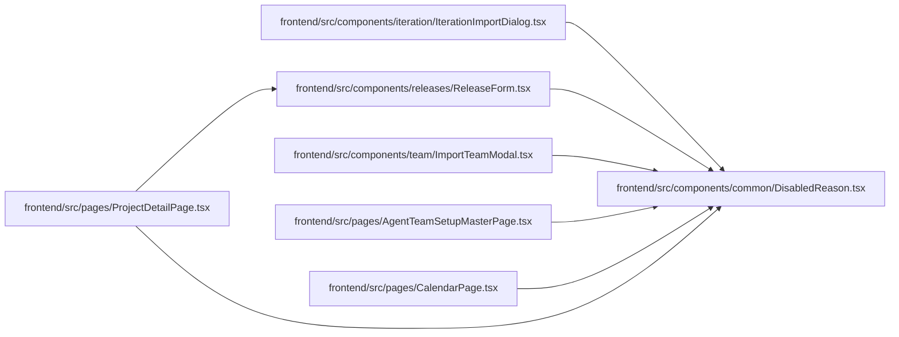

# DisabledReason Module

**Path:** `frontend/src/components/common/DisabledReason.tsx`

## Description

_Auto-generated from `frontend/src/components/common/DisabledReason.tsx`._

## Imports

| Source | Symbols | Type-only | Runtime emission |
|--------|---------|-----------|------------------|
| `clsx` | `clsx` | — | compiler-dependent |

## Module Signals

| Signal | Values |
|--------|--------|
| Exports | `DisabledReason` |

## Local dependency map

<!-- Auto-generated local dependency summary. Do not edit by hand. -->

### Internal neighbors

| Direction | Module |
|---|---|
| Inbound | [IterationImportDialog](../modules/IterationImportDialog.md) |
| Inbound | [ReleaseForm](../modules/ReleaseForm.md) |
| Inbound | [ImportTeamModal](../modules/ImportTeamModal.md) |
| Inbound | [AgentTeamSetupMasterPage](../modules/AgentTeamSetupMasterPage.md) |
| Inbound | [CalendarPage](../modules/CalendarPage.md) |
| Inbound | [ProjectDetailPage](../modules/ProjectDetailPage.md) |

### External packages

| Language | Used packages | Undeclared packages |
|---|---:|---:|
| typescript | 1 | 0 |

## Functions

| Function | Signature | Decorators | Description |
|----------|-----------|------------|-------------|
| `DisabledReason` | `({ reason, className }: { reason?: string \| null \| false; className?: string })` | — | Says, next to a disabled button, what would enable it. Renders nothing when there is no reason. |
