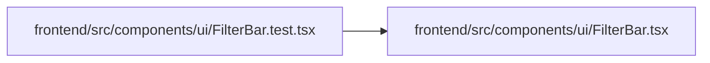

# FilterBar Module

**Path:** `frontend/src/components/ui/FilterBar.tsx`

## Description

_Auto-generated from `frontend/src/components/ui/FilterBar.tsx`._

## Imports

| Source | Symbols | Type-only | Runtime emission |
|--------|---------|-----------|------------------|
| `clsx` | `clsx` | — | compiler-dependent |
| `lucide-react` | `ChevronDown`, `X` | — | compiler-dependent |
| `react` | `ReactNode` | Declaration | erased |
| `react` | `useEffect`, `useId`, `useRef`, `useState` | — | compiler-dependent |
| `react-i18next` | `useTranslation` | — | compiler-dependent |

## Module Signals

| Signal | Values |
|--------|--------|
| Exports | `FilterBar`, `FilterBarFilter`, `FilterBarOption` |
| Constants | `QUICK_FILTER_LIMIT` |

## Local dependency map

<!-- Auto-generated local dependency summary. Do not edit by hand. -->
This graph shows full source coupling. Type dependencies can be erased; compiler-dependent cycle groups are runtime candidates, not confirmed initialization cycles.

### Internal neighbors

| Direction | Module |
|---|---|
| Inbound | [FilterBar.test](../modules/FilterBar.test.md) |

### External packages

| Language | Used packages | Undeclared packages |
|---|---:|---:|
| typescript | 4 | 0 |

## Classes

| Class | Kind | Line | Bases / Target | Description |
|-------|------|------|----------------|-------------|
| [FilterBarOption](../entities/FilterBarOption.md) | Type alias | 7 | <pre><code>&#123;&#10;    value&#58; string&#59;&#10;    label&#58; string&#59;&#10;&#125;</code></pre> | — |
| [FilterBarFilter](../entities/FilterBarFilter.md) | Type alias | 12 | <pre><code>&#123;&#10;    &#47;&#42;&#42; Stable key passed back to &#96;onChange&#96;&#46; &#42;&#47;&#10;    id&#58; string&#59;&#10;    &#47;&#42;&#42; Names the filter in its control&#44; its chip and the remove button&#46; &#42;&#47;&#10;    label&#58; string&#59;&#10;    options&#58; FilterBarOption&#91;&#93;&#59;&#10;    &#47;&#42;&#42; The chosen option&#39;s value&#59; an empty string means the filter is off&#46; &#42;&#47;&#10;    value&#58; string&#59;&#10;    &#47;&#42;&#42; &#96;date&#96; shows a date field instead of a list&#59; the chip shows the matching option&#39;s label when there is one&#46; &#42;&#47;&#10;    type&#63;&#58; &#39;select&#39; &#124; &#39;date&#39;&#59;&#10;    &#47;&#42;&#42;&#10;     &#42; A condition with no control of its own&#44; shown only as its chip&#58; one value of a filter that&#10;     &#42; holds several&#44; or a condition another page handed over&#46; Removing the chip sends &#96;onChange&#40;id&#44; &#39;&#39;&#41;&#96;&#46;&#10;     &#42;&#47;&#10;    chipOnly&#63;&#58; boolean&#59;&#10;&#125;</code></pre> | — |

## Functions

| Function | Signature | Decorators | Description |
|----------|-----------|------------|-------------|
| `FilterBar` | <pre><code>&#40;&#123; filters&#44; onChange&#44; onClear&#44; quickLimit &#61; QUICK&#95;FILTER&#95;LIMIT&#44; className &#125;&#58; &#123;&#10;    filters&#58; FilterBarFilter&#91;&#93;&#59;&#10;    onChange&#58; &#40;id&#58; string&#44; value&#58; string&#41; &#61;&#62; void&#59;&#10;    onClear&#58; &#40;&#41; &#61;&#62; void&#59;&#10;    &#47;&#42;&#42; How many filters stay in the row&#44; at most five&#59; a toolbar short of room shows fewer&#46; &#42;&#47;&#10;    quickLimit&#63;&#58; number&#59;&#10;    className&#63;&#58; string&#59;&#10;&#125;&#41;</code></pre> | — | The one filter control every list page shares. |
