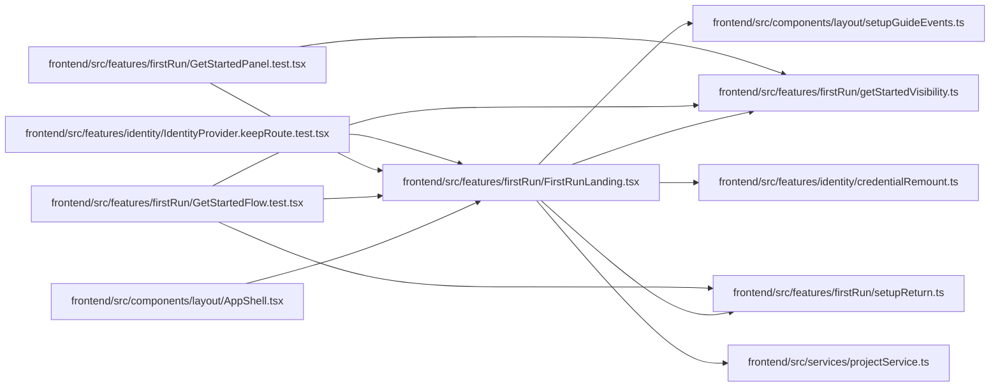

# FirstRunLanding Module

**Path:** `frontend/src/features/firstRun/FirstRunLanding.tsx`

## Description

_Auto-generated from `frontend/src/features/firstRun/FirstRunLanding.tsx`._

## Imports

| Source | Symbols | Type-only | Runtime emission |
|--------|---------|-----------|------------------|
| `../../components/layout/setupGuideEvents` | `OPEN_SETUP_GUIDE_EVENT` | — | compiler-dependent |
| `../../services/projectService` | `projectService` | — | compiler-dependent |
| `../identity/credentialRemount` | `consumeCredentialRemount` | — | compiler-dependent |
| `./getStartedVisibility` | `useGetStartedVisibility` | — | compiler-dependent |
| `./setupReturn` | `useSetupReturn` | — | compiler-dependent |
| `@tanstack/react-query` | `useQuery` | — | compiler-dependent |
| `react` | `useEffect`, `useRef` | — | compiler-dependent |
| `react-router-dom` | `useLocation`, `useNavigate`, `useNavigationType` | — | compiler-dependent |

## Module Signals

| Signal | Values |
|--------|--------|
| Exports | `FirstRunLanding` |
| Constants | `OVERVIEW_PATH` |

## Local dependency map

<!-- Auto-generated local dependency summary. Do not edit by hand. -->

### Internal neighbors

| Direction | Module |
|---|---|
| Inbound | [AppShell](../modules/AppShell.md) |
| Inbound | [GetStartedFlow.test](../modules/GetStartedFlow.test.md) |
| Inbound | [GetStartedPanel.test](../modules/GetStartedPanel.test.md) |
| Inbound | [IdentityProvider.keepRoute.test](../modules/IdentityProvider.keepRoute.test.md) |
| Outbound | [setupGuideEvents](../modules/setupGuideEvents.md) |
| Outbound | [getStartedVisibility](../modules/getStartedVisibility.md) |
| Outbound | [setupReturn](../modules/setupReturn.md) |
| Outbound | [credentialRemount](../modules/credentialRemount.md) |
| Outbound | [projectService](../modules/projectService.md) |

### External packages

| Language | Used packages | Undeclared packages |
|---|---:|---:|
| typescript | 3 | 0 |

## Functions

| Function | Signature | Decorators | Description |
|----------|-----------|------------|-------------|
| `FirstRunLanding` | `()` | — | Two ways into the Get started panel on Overview. A workspace with no project opens on |
