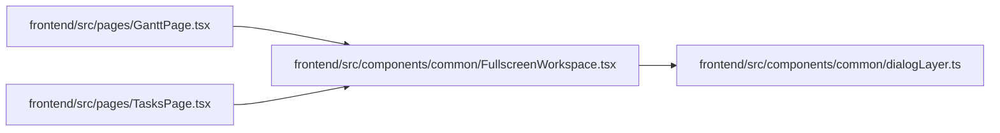

# FullscreenWorkspace Module

**Path:** `frontend/src/components/common/FullscreenWorkspace.tsx`

## Description

_Auto-generated from `frontend/src/components/common/FullscreenWorkspace.tsx`._

## Imports

| Source | Symbols | Type-only | Runtime emission |
|--------|---------|-----------|------------------|
| `./dialogLayer` | `useDialogLayer` | — | compiler-dependent |
| `clsx` | `clsx` | — | compiler-dependent |
| `react` | `ReactNode`, `RefObject` | Declaration | erased |

## Module Signals

| Signal | Values |
|--------|--------|
| Exports | `FullscreenWorkspace` |

## Local dependency map

<!-- Auto-generated local dependency summary. Do not edit by hand. -->

### Internal neighbors

| Direction | Module |
|---|---|
| Inbound | [GanttPage](../modules/GanttPage.md) |
| Inbound | [TasksPage](../modules/TasksPage.md) |
| Outbound | [dialogLayer](../modules/dialogLayer.md) |

### External packages

| Language | Used packages | Undeclared packages |
|---|---:|---:|
| typescript | 2 | 0 |

## Functions

| Function | Signature | Decorators | Description |
|----------|-----------|------------|-------------|
| `FullscreenWorkspace` | <pre><code>&#40;&#123;&#10;    open&#44;&#10;    onClose&#44;&#10;    ariaLabel&#44;&#10;    children&#44;&#10;    className&#44;&#10;    fullscreenClassName&#44;&#10;    initialFocusRef&#44;&#10;&#125;&#58; &#123;&#10;    open&#58; boolean&#59;&#10;    onClose&#58; &#40;&#41; &#61;&#62; void&#59;&#10;    ariaLabel&#58; string&#59;&#10;    children&#58; ReactNode&#59;&#10;    className&#63;&#58; string&#59;&#10;    fullscreenClassName&#63;&#58; string&#59;&#10;    initialFocusRef&#63;&#58; RefObject&#60;HTMLElement &#124; null&#62;&#59;&#10;&#125;&#41;</code></pre> | — | — |
