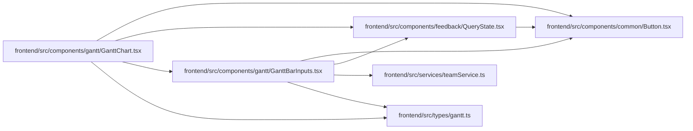

# GanttBarInputs Module

**Path:** `frontend/src/components/gantt/GanttBarInputs.tsx`

## Description

_Auto-generated from `frontend/src/components/gantt/GanttBarInputs.tsx`._

## Imports

| Source | Symbols | Type-only | Runtime emission |
|--------|---------|-----------|------------------|
| `../../services/teamService` | `teamService` | — | compiler-dependent |
| `../../types/gantt` | `GanttTask` | Declaration | erased |
| `../common/Button` | `Button` | — | compiler-dependent |
| `../feedback/QueryState` | `QueryErrorState` | — | compiler-dependent |
| `@tanstack/react-query` | `useQuery` | — | compiler-dependent |
| `react` | `useEffect`, `useId`, `useRef`, `useState` | — | compiler-dependent |
| `react-i18next` | `useTranslation` | — | compiler-dependent |

## Module Signals

| Signal | Values |
|--------|--------|
| Exports | `GanttBarInputChanges`, `GanttBarInputs` |

## Local dependency map

<!-- Auto-generated local dependency summary. Do not edit by hand. -->
This graph shows full source coupling. Type dependencies can be erased; compiler-dependent cycle groups are runtime candidates, not confirmed initialization cycles.

### Internal neighbors

| Direction | Module |
|---|---|
| Inbound | [GanttChart](../modules/GanttChart.md) |
| Outbound | [Button](../modules/Button.md) |
| Outbound | [QueryState](../modules/QueryState.md) |
| Outbound | [teamService](../modules/teamService.md) |
| Outbound | [types_gantt](../modules/types_gantt.md) |

### External packages

| Language | Used packages | Undeclared packages |
|---|---:|---:|
| typescript | 3 | 0 |

## Classes

| Class | Kind | Line | Bases / Target | Description |
|-------|------|------|----------------|-------------|
| [GanttBarInputChanges](../entities/GanttBarInputChanges.md) | Interface | 9 | — | — |
| [GanttBarInputsProps](../entities/GanttBarInputsProps.md) | Interface | 17 | — | — |

## Functions

| Function | Signature | Decorators | Description |
|----------|-----------|------------|-------------|
| `GanttBarInputs` | `({ task, iterationId, taskOptions, anchor, onApply, onMoreFields, onClose }: GanttBarInputsProps)` | — | The five inputs that move a task's dates. Dates themselves are scheduler |
