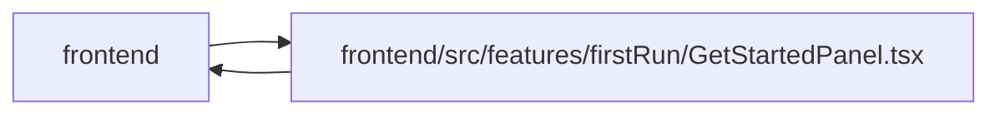

# GetStartedPanel Module

**Path:** `frontend/src/features/firstRun/GetStartedPanel.tsx`

## Description

_Auto-generated from `frontend/src/features/firstRun/GetStartedPanel.tsx`._

## Imports

| Source | Symbols | Type-only | Runtime emission |
|--------|---------|-----------|------------------|
| `../../components/common/Button` | `Button` | — | compiler-dependent |
| `../../components/common/ButtonLink` | `ButtonLink` | — | compiler-dependent |
| `../identity/LocalProfilePicker` | `LocalProfilePicker` | — | compiler-dependent |
| `../identity/identityContext` | `useIdentity` | — | compiler-dependent |
| `../scope/useScopeLink` | `useScopeLink` | — | compiler-dependent |
| `../scope/useWorkScope` | `useSetWorkScope` | — | compiler-dependent |
| `./CreateProjectModal` | `CreateProjectModal` | — | compiler-dependent |
| `./SampleProjectAction` | `SampleProjectAction` | — | compiler-dependent |
| `./firstRunSteps` | `FirstRunStep`, `FirstRunStepId` | Specifier | compiler-dependent |
| `./firstRunSteps` | `FIRST_RUN_PLAN_CHECKPOINT`, `firstRunPlanHref` | — | compiler-dependent |
| `./getStartedVisibility` | `useGetStartedVisibility` | — | compiler-dependent |
| `./useFirstRunProgress` | `FirstRunProgress` | Declaration | erased |
| `clsx` | `clsx` | — | compiler-dependent |
| `lucide-react` | `ArrowRight`, `Check`, `ChevronDown`, `X` | — | compiler-dependent |
| `react` | `ReactNode` | Declaration | erased |
| `react` | `useState` | — | compiler-dependent |
| `react-i18next` | `useTranslation` | — | compiler-dependent |

## Module Signals

| Signal | Values |
|--------|--------|
| Exports | `GetStartedPanel` |
| Constants | `TITLE_ID` |

## Local dependency map

<!-- Auto-generated local dependency summary. Do not edit by hand. -->
This graph shows full source coupling. Type dependencies can be erased; compiler-dependent cycle groups are runtime candidates, not confirmed initialization cycles.

> Module-level dependencies exceed the generated-diagram limits, so the diagram and table below group them by top-level package. Counts report the number of module neighbors in each package.

### Internal neighbors

| Direction | Module |
|---|---|
| Inbound | `frontend` (2) |
| Outbound | `frontend` (11) |

### External packages

| Language | Used packages | Undeclared packages |
|---|---:|---:|
| typescript | 4 | 0 |

> All 13 module neighbor(s) are summarized by package because the module-level view exceeds the 12-node limit.

## Functions

| Function | Signature | Decorators | Description |
|----------|-----------|------------|-------------|
| `GetStartedPanel` | `({ progress, secondaryAction }: { progress: FirstRunProgress; secondaryAction?: ReactNode })` | — | The Get started panel: six steps from an empty workspace to its first applied schedule. |
