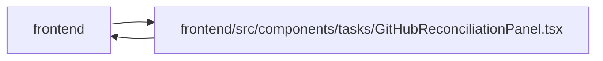

# GitHubReconciliationPanel Module

**Path:** `frontend/src/components/tasks/GitHubReconciliationPanel.tsx`

## Description

Task-page panel that lists each linked pull request against the submitted commit (state, head, checks, target branch, merge outcome, review, differences and the next owner's action), also for a successor task. People who can edit can run catch-up; it replaces the view, hands the refreshed task to the page and invalidates the delivery prerequisite list.

## Imports

| Source | Symbols | Type-only | Runtime emission |
|--------|---------|-----------|------------------|
| `../../features/identity/useProjectEditAccess` | `useProjectEditAccess` | — | compiler-dependent |
| `../../services/githubService` | `githubService` | — | compiler-dependent |
| `../../services/taskService` | `taskService` | — | compiler-dependent |
| `../../types/github` | `GitHubPullReconciliation`, `GitHubReconciliation` | Declaration | erased |
| `../../types/task` | `Task` | Declaration | erased |
| `../../utils/apiError` | `getApiErrorMessage` | — | compiler-dependent |
| `../../utils/formatDate` | `formatDateTime` | — | compiler-dependent |
| `../common/Button` | `Button` | — | compiler-dependent |
| `../feedback/QueryState` | `QueryErrorState` | — | compiler-dependent |
| `./taskViewSession` | `TaskViewSession`, `TaskViewSessionUpdate` | Declaration | erased |
| `@tanstack/react-query` | `useMutation`, `useQuery`, `useQueryClient` | — | compiler-dependent |
| `react` | `useId` | — | compiler-dependent |
| `react-i18next` | `useTranslation` | — | compiler-dependent |

## Module Signals

| Signal | Values |
|--------|--------|
| Exports | `GitHubReconciliationPanel` |
| Constants | `KNOWN_DIFFERENCES`, `KNOWN_OWNERS`, `KNOWN_STATES`, `KNOWN_REVIEWS`, `KNOWN_SOURCES`, `KNOWN_CHECKS` |

## Local dependency map

<!-- Auto-generated local dependency summary. Do not edit by hand. -->
This graph shows full source coupling. Type dependencies can be erased; compiler-dependent cycle groups are runtime candidates, not confirmed initialization cycles.

> Module-level dependencies exceed the generated-diagram limits, so the diagram and table below group them by top-level package. Counts report the number of module neighbors in each package.

### Internal neighbors

| Direction | Module |
|---|---|
| Inbound | `frontend` (2) |
| Outbound | `frontend` (10) |

### External packages

| Language | Used packages | Undeclared packages |
|---|---:|---:|
| typescript | 3 | 0 |

> All 12 module neighbor(s) are summarized by package because the module-level view exceeds the 12-node limit.

## Functions

| Function | Signature | Decorators | Description |
|----------|-----------|------------|-------------|
| `GitHubReconciliationPanel` | <pre><code>&#40;&#123; task&#44; session&#44; onSession&#44; onTaskUpdated &#125;&#58; &#123;&#10;    task&#58; Task&#59; session&#58; TaskViewSession&#59; onSession&#58; TaskViewSessionUpdate&#59; onTaskUpdated&#58; &#40;task&#58; Task&#41; &#61;&#62; void&#59;&#10;&#125;&#41;</code></pre> | — | Per linked pull request: the submitted commit against what GitHub last showed, and who acts next. |
