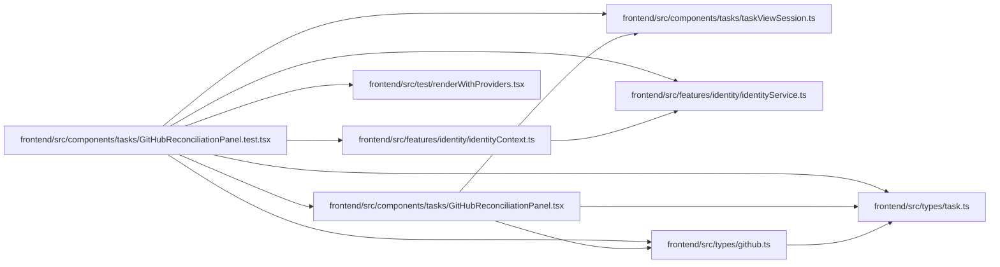

# GitHubReconciliationPanel.test Module

**Path:** `frontend/src/components/tasks/GitHubReconciliationPanel.test.tsx`

## Description

Covers the panel's states (unobserved, stale head, merge with branch and commit, missing base branch, closed unmerged, unknown codes, no pull requests, load retry) and catch-up (edit-only, refreshed view and task, task refresh failure, busy state, failure message).

## Imports

| Source | Symbols | Type-only | Runtime emission |
|--------|---------|-----------|------------------|
| `../../features/identity/identityContext` | `IdentityContext` | — | compiler-dependent |
| `../../features/identity/identityService` | `WorkspaceIdentity` | Declaration | erased |
| `../../test/renderWithProviders` | `renderWithProviders` | — | compiler-dependent |
| `../../types/github` | `GitHubPullReconciliation`, `GitHubReconciliation` | Declaration | erased |
| `../../types/task` | `Task` | Declaration | erased |
| `./GitHubReconciliationPanel` | `GitHubReconciliationPanel` | — | compiler-dependent |
| `./taskViewSession` | `useTaskViewSession` | — | compiler-dependent |
| `@testing-library/react` | `screen`, `waitFor` | — | compiler-dependent |
| `vitest` | `beforeEach`, `describe`, `expect`, `it`, `vi` | — | compiler-dependent |

## Module Signals

| Signal | Values |
|--------|--------|
| Constants | `service`, `tasks`, `task`, `onTaskUpdated` |
| Module calls | `service = hoisted`, `tasks = hoisted`, `mock`, `mock`, `onTaskUpdated = fn`, `beforeEach`, `describe` |

## Local dependency map

<!-- Auto-generated local dependency summary. Do not edit by hand. -->
This graph shows full source coupling. Type dependencies can be erased; compiler-dependent cycle groups are runtime candidates, not confirmed initialization cycles.

### Internal neighbors

| Direction | Module |
|---|---|
| Outbound | [GitHubReconciliationPanel](../modules/GitHubReconciliationPanel.md) |
| Outbound | [taskViewSession](../modules/taskViewSession.md) |
| Outbound | [identityContext](../modules/identityContext.md) |
| Outbound | [identityService](../modules/identityService.md) |
| Outbound | [renderWithProviders](../modules/renderWithProviders.md) |
| Outbound | [types_github](../modules/types_github.md) |
| Outbound | [types_task](../modules/types_task.md) |

### External packages

| Language | Used packages | Undeclared packages |
|---|---:|---:|
| typescript | 2 | 0 |
