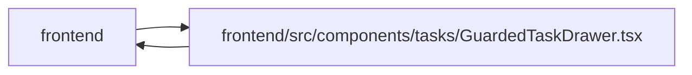

# GuardedTaskDrawer Module

**Path:** `frontend/src/components/tasks/GuardedTaskDrawer.tsx`

## Description

An edit opening requests the authoritative task detail under its own opening ID. The form takes one initial snapshot from that read, including the task version. Later background reads do not replace an active draft. A failed opening shows the read error and offers a retry.

## Imports

| Source | Symbols | Type-only | Runtime emission |
|--------|---------|-----------|------------------|
| `../../types/task` | `Task` | Declaration | erased |
| `../feedback/QueryState` | `QueryErrorState`, `QueryLoadingState` | — | compiler-dependent |
| `../ui/SlideOverDrawer` | `SlideOverDrawer` | — | compiler-dependent |
| `./DraftDismissalDialog` | `DraftDismissalDialog` | — | compiler-dependent |
| `./TaskForm` | `TaskForm` | — | compiler-dependent |
| `./taskEditorSnapshot` | `readTaskEditorSnapshot`, `keepNewestTaskSnapshot` | — | compiler-dependent |
| `./useDraftDismissal` | `useDraftDismissal` | — | compiler-dependent |
| `@tanstack/react-query` | `useQuery` | — | compiler-dependent |
| `react` | `ComponentProps`, `ReactNode`, `RefObject` | Specifier | compiler-dependent |
| `react` | `useId`, `useState` | — | compiler-dependent |
| `react-i18next` | `useTranslation` | — | compiler-dependent |

## Module Signals

| Signal | Values |
|--------|--------|
| Exports | `CurrentTaskDrawer`, `GuardedTaskDrawer` |

## Local dependency map

<!-- Auto-generated local dependency summary. Do not edit by hand. -->
This graph shows full source coupling. Type dependencies can be erased; compiler-dependent cycle groups are runtime candidates, not confirmed initialization cycles.

> Module-level dependencies exceed the generated-diagram limits, so the diagram and table below group them by top-level package. Counts report the number of module neighbors in each package.

### Internal neighbors

| Direction | Module |
|---|---|
| Inbound | `frontend` (6) |
| Outbound | `frontend` (7) |

### External packages

| Language | Used packages | Undeclared packages |
|---|---:|---:|
| typescript | 3 | 0 |

> All 13 module neighbor(s) are summarized by package because the module-level view exceeds the 12-node limit.

## Classes

| Class | Kind | Line | Bases / Target | Description |
|-------|------|------|----------------|-------------|
| [FormProps](../entities/FormProps.md) | Type alias | 12 | `Omit<ComponentProps<typeof TaskForm>, 'onSuccess' \| 'onCancel' \| 'onDirtyChange' \| 'onPendingChange' \| 'onDiscardReady' \| 'confirmUnsavedOnCancel'>` | — |

## Functions

| Function | Signature | Decorators | Description |
|----------|-----------|------------|-------------|
| `GuardedTaskDrawer` | <pre><code>&#40;&#123; title&#44; closeLabel&#44; onClose&#44; restoreFocusRef&#44; &#46;&#46;&#46;form &#125;&#58; FormProps &#38; &#123;&#10;    title&#58; ReactNode&#59; closeLabel&#58; string&#59; onClose&#58; &#40;&#41; &#61;&#62; void&#59;&#10;    &#47;&#42;&#42; Where focus goes on close when the drawer was not opened from a control on this page&#46; &#42;&#47;&#10;    restoreFocusRef&#63;&#58; RefObject&#60;HTMLElement &#124; null&#62;&#59;&#10;&#125;&#41;</code></pre> | — | — |
| `CurrentTaskDrawer` | `({ taskId, onClose }: { taskId: number; onClose: () => void })` | — | — |
