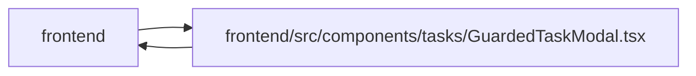

# GuardedTaskModal Module

**Path:** `frontend/src/components/tasks/GuardedTaskModal.tsx`

## Description

Current task modal openings own a unique, abortable authoritative detail read and wait before constructing a clean form. One coherent snapshot initializes title, version, criteria and acceptance. Background reads preserve active input and its observed version; lower and obsolete responses cannot rebase it. Failed or denied reads withhold server actions, with isolated task draft recovery preserved.

## Imports

| Source | Symbols | Type-only | Runtime emission |
|--------|---------|-----------|------------------|
| `../../types/task` | `Task` | Declaration | erased |
| `../common/Modal` | `Modal` | — | compiler-dependent |
| `../feedback/QueryState` | `QueryErrorState`, `QueryLoadingState` | — | compiler-dependent |
| `./DraftDismissalDialog` | `DraftDismissalDialog` | — | compiler-dependent |
| `./TaskForm` | `TaskForm` | — | compiler-dependent |
| `./taskEditorSnapshot` | `readTaskEditorSnapshot`, `keepNewestTaskSnapshot` | — | compiler-dependent |
| `./useDraftDismissal` | `useDraftDismissal` | — | compiler-dependent |
| `@tanstack/react-query` | `useQuery` | — | compiler-dependent |
| `react` | `ComponentProps`, `ReactNode` | Specifier | compiler-dependent |
| `react` | `useId`, `useState` | — | compiler-dependent |
| `react-i18next` | `useTranslation` | — | compiler-dependent |

## Module Signals

| Signal | Values |
|--------|--------|
| Exports | `CurrentTaskModal`, `GuardedTaskModal` |

## Local dependency map

<!-- Auto-generated local dependency summary. Do not edit by hand. -->
This graph shows full source coupling. Type dependencies can be erased; compiler-dependent cycle groups are runtime candidates, not confirmed initialization cycles.

> Module-level dependencies exceed the generated-diagram limits, so the diagram and table below group them by top-level package. Counts report the number of module neighbors in each package.

### Internal neighbors

| Direction | Module |
|---|---|
| Inbound | `frontend` (6) |
| Outbound | `frontend` (7) |

### External packages

| Language | Used packages | Undeclared packages |
|---|---:|---:|
| typescript | 3 | 0 |

> All 13 module neighbor(s) are summarized by package because the module-level view exceeds the 12-node limit.

## Classes

| Class | Kind | Line | Bases / Target | Description |
|-------|------|------|----------------|-------------|
| [FormProps](../entities/FormProps.md) | Type alias | 12 | `Omit<ComponentProps<typeof TaskForm>, 'onSuccess' \| 'onCancel' \| 'onDirtyChange' \| 'onPendingChange' \| 'onDiscardReady' \| 'confirmUnsavedOnCancel'>` | — |

## Functions

| Function | Signature | Decorators | Description |
|----------|-----------|------------|-------------|
| `GuardedTaskModal` | <pre><code>&#40;&#123; title&#44; closeLabel&#44; onClose&#44; &#46;&#46;&#46;form &#125;&#58; FormProps &#38; &#123;&#10;    title&#58; ReactNode&#59; closeLabel&#58; string&#59; onClose&#58; &#40;&#41; &#61;&#62; void&#59;&#10;&#125;&#41;</code></pre> | — | — |
| `CurrentTaskModal` | `({ taskId, onClose }: { taskId: number; onClose: () => void })` | — | — |